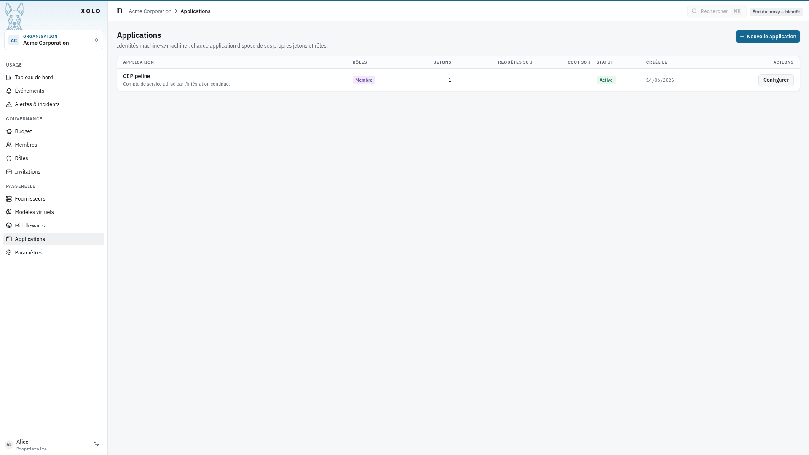
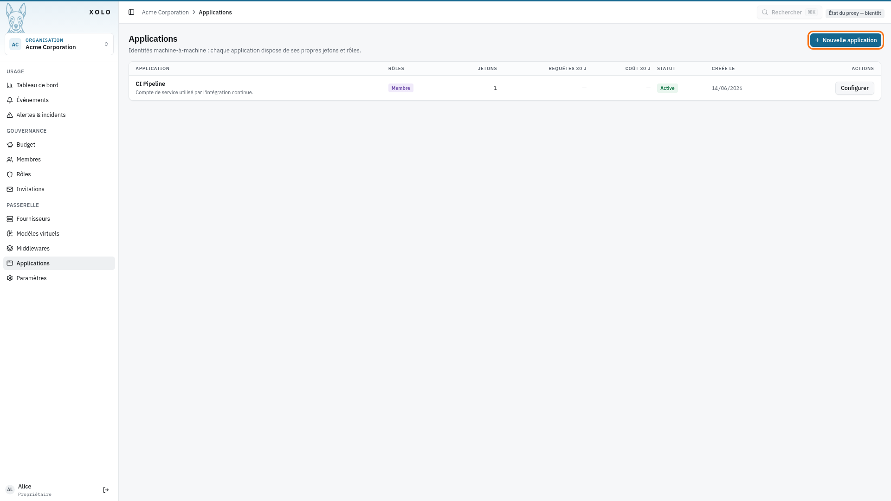
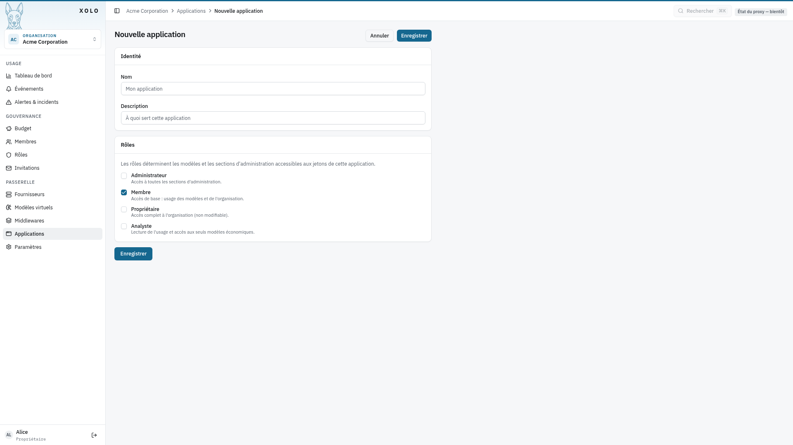
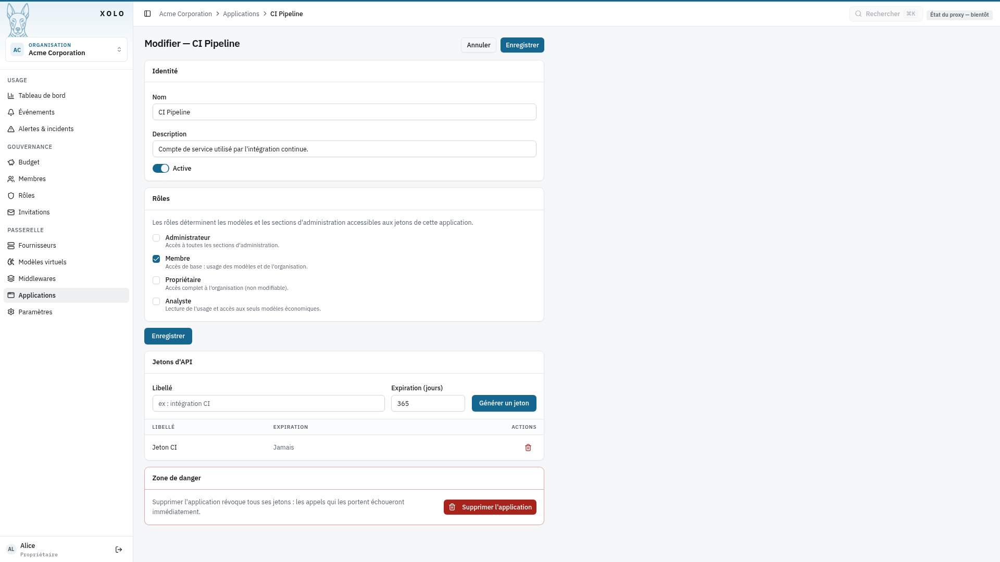
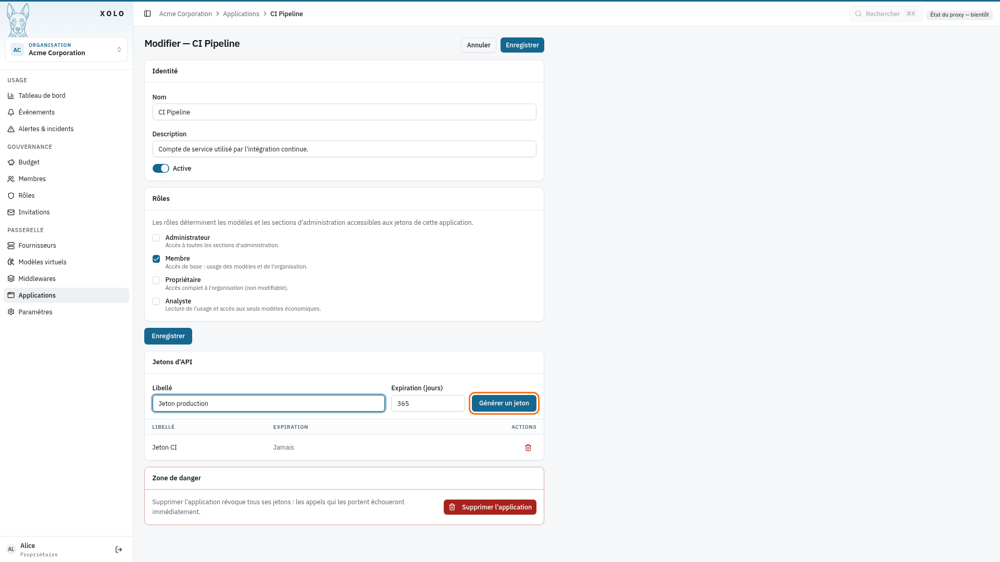
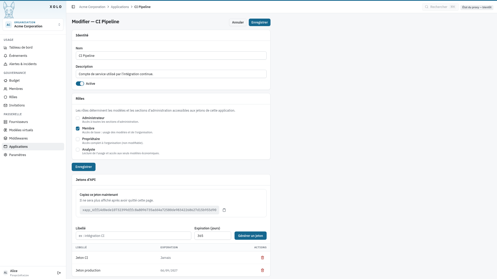
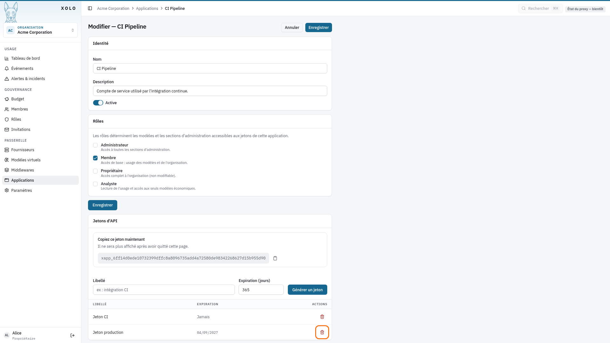

# Applications



## Qu'est-ce qu'une application ?

Une application est une configuration M2M (machine-to-machine) qui permet à des services externes de se connecter à Xolo. Chaque application dispose de ses propres jetons API pour l'authentification.

### Cas d'usage

- **OpenWebUI** : intégration avec l'interface web OpenWebUI
- **Scripts automatisés** : scripts ou services qui interrogent l'API Xolo
- **CI/CD** : intégration dans des pipelines de développement
- **Applications personnalisées** : toute application nécessitant un accès programmatique

## Accéder aux applications

1. Allez dans votre organisation : `/orgs/{slug}/`
2. Cliquez sur **Applications** dans le menu admin
   

> **Note** : Vous devez disposer de la permission `applications:write` pour créer ou modifier des applications.

## Créer une application

1. Cliquez sur **Nouvelle application**
   

2. Remplissez les informations :
   

| Champ           | Description                                       |
| --------------- | ------------------------------------------------- |
| **Nom**         | Nom de l'application (ex: "OpenWebUI Production") |
| **Description** | Description optionnelle                           |
| **Équipe**      | Équipe à laquelle l'application est rattachée (optionnel) |

3. Cliquez sur **Enregistrer**.

Une application rattachée à une [équipe](../equipes/equipes.md) utilise les modèles de l'équipe, et toutes ses requêtes sont débitées sur le budget de l'équipe. Elle ne peut pas nommer une autre équipe. Ses rôles continuent de régler les sections d'administration qu'elle atteint et, avec `model:use:org`, l'accès à tous les modèles de l'organisation.

## Gérer les tokens API

Chaque application peut disposer de plusieurs tokens API.

### Générer un token

1. Ouvrez l'application en modification
   
2. Dans la section **Jetons d'API**, remplissez :
   - **Libellé** : nom descriptif (ex: "Jeton production")
   - **Expiration (jours)** : durée de validité (ex: 365 pour 1 an)
3. Cliquez sur **Générer un jeton**
   
4. Résultat :
   

### Révoquer un token

Pour révoquer un token (le rendre invalide immédiatement) :

- Cliquez sur l'icône **Révoquer** (corbeille) sur la ligne du token concerné, puis confirmez
  

> **Attention** : Un token révoqué ne peut pas être récupéré. Vous devez en générer un nouveau.

### Expiration des tokens

| Situation                     | Comportement                                         |
| ----------------------------- | ---------------------------------------------------- |
| **Date d'expiration définie** | Le token devient invalide à la date indiquée         |
| **Aucune expiration**         | Le token reste valide jusqu'à sa révocation manuelle |

## Modifier ou désactiver une application

1. Cliquez sur **Modifier** sur la ligne de l'application
2. Modifiez les informations :
   - **Nom** : nouveau nom de l'application
   - **Description** : nouvelle description
   - **Active** : cochez/décochez pour activer ou désactiver

> **Note** : Une application désactivée ne peut plus utiliser ses tokens API.

## Supprimer une application

1. Ouvrez l'application en modification
2. Dans la **Zone de danger**, cliquez sur **Supprimer l'application**

> **Attention** : Cette action supprime également tous les tokens associés. Les services utilisant ces tokens perdront immédiatement leur accès.

## Jetons d'application vs jetons utilisateurs

Xolo propose deux types de jetons d'authentification :

| Caractéristique | Jetons d'application                               | Jetons API utilisateurs                 |
| --------------- | -------------------------------------------------- | --------------------------------------- |
| **Création**    | Par un admin, dans les paramètres de l'application | Par chaque utilisateur, dans son profil |
| **Expiration**  | Configurable (ex: 365 jours)                       | Configurable, ou illimitée              |
| **Cas d'usage** | Services M2M (OpenWebUI, scripts)                  | Accès personnel à l'API                 |
| **Identité**    | L'application est identifiée, pas l'utilisateur    | L'utilisateur est identifié             |

### Recommandations

- Utilisez les **jetons d'application** pour les services automatisés (CI/CD, scripts, OpenWebUI)
- Utilisez les **jetons API utilisateurs** pour l'accès personnel à l'API

## Utilisation des tokens API

### Format d'authentification

Utilisez le token dans l'en-tête HTTP `Authorization` :

```bash
Authorization: Bearer <votre_token_api>
```

### Exemple avec curl

```bash
curl -X POST https://xolo.example.com/v1/chat/completions \
  -H "Authorization: Bearer xlo_abc123def456" \
  -H "Content-Type: application/json" \
  -d '{
    "model": "mon-org/gpt-4o",
    "messages": [{"role": "user", "content": "Hello!"}]
  }'
```

### Portée d'un token et endpoint `GET /api/v1/models`

Un token (application ou utilisateur) est rattaché à **une seule organisation** :
celle dans laquelle il a été émis. Cette portée s'applique de la même
manière à toutes les requêtes authentifiées par ce token, y compris
`GET /api/v1/models`, qui renvoie uniquement les modèles activés de cette
organisation.

Concrètement :

- **Jeton d'application** : `GET /api/v1/models` renvoie les modèles activés de l'organisation de l'application.
- **Jeton d'utilisateur multi-organisations** : `GET /api/v1/models` ne renvoie que les modèles activés de l'organisation du jeton (les autres appartenances de l'utilisateur sont ignorées, comme pour le proxy). Les modèles virtuels personnels (`~/...`) suivent une règle distincte : ils sont inclus dès lors que l'utilisateur dispose de la permission `personal-vm:create` (ou du rôle owner) dans **au moins une** des organisations retenues par le scope ci-dessus. La liste n'est cependant pas filtrée par organisation : le modèle de données (`internal/core/model/personal_virtual_model.go`) rattache chaque modèle virtuel personnel à son `user_id` sans colonne `OrgID`, donc tous les `~/...` appartenant à cet utilisateur sont renvoyés.
- **Session OIDC (utilisateur humain)** : `GET /api/v1/models` renvoie l'union des modèles activés de toutes les organisations dont l'utilisateur est membre.
- **Équipes** : un modèle accessible par une équipe est listé sous la forme `<organisation>/<équipe>/<modèle>`, une fois par équipe ; un modèle accessible par `model:use:org` l'est sous la forme `<organisation>/<modèle>`. Un jeton rattaché à une équipe ne voit que les noms de son équipe.
- **Session issue de `POST /auth/token/login`** : la session est créée à partir d'un jeton Xolo (utilisateur ou application) et `authn.User.OrgID` est rempli avec l'organisation du jeton (`internal/http/middleware/authn/token/login.go`). `GET /api/v1/models` ne renvoie alors que les modèles activés de cette organisation, comme pour le cas « Jeton » correspondant (les autres appartenances de l'utilisateur sont ignorées ; pour une application, c'est précisément l'organisation de l'application). Ce cas se distingue du précédent uniquement par le canal d'authentification (cookie de session au lieu de header `Authorization`).

### Capacités et tarif des modèles listés

Chaque modèle de `GET /api/v1/models` suit le format OpenRouter :

- `description` ;
- `context_length` ;
- `top_provider.context_length` et `top_provider.max_completion_tokens`, la fenêtre de contexte et le nombre maximal de tokens que le modèle peut écrire dans une réponse, pour dimensionner `max_tokens`. Un modèle virtuel publie les plus petites fenêtres de ses candidats, ou sa surcharge `MaxOutputTokens`. Une fenêtre inconnue est omise, et seuls les modèles de complétion ont cet objet. `per_request_limits` reste la limite de tokens fixée par l'opérateur ;
- `architecture.input_modalities`, qui contient `image` quand le modèle lit les images ;
- `supported_parameters`, qui contient `tools` et `reasoning` selon ses capacités ;
- `pricing.prompt` et `pricing.completion`, exprimés en unités monétaires pour 1 000 tokens.

Xolo y ajoute un objet `xolo` :

```json
"xolo": {"capabilities_declared": true, "currency": "EUR"}
```

- `capabilities_declared` vaut `false` pour un modèle virtuel dont le pipeline ne permet pas de déduire les capacités et qui n'en déclare pas dans son catalogue. Sa fiche se lit alors comme un modèle texte seul, gratuit : ces valeurs nulles signifient « inconnu », pas « absent ».
- `currency` est la devise du fournisseur du modèle. Elle est absente quand le prix n'est pas connu, par exemple pour un modèle virtuel non déduit, pour des candidats facturés dans des devises différentes, ou quand la liste des fournisseurs n'a pas pu être lue.

> **Note** : Avant la correction du bug [#48](https://github.com/xolo-gateway/xolo/issues/48),
> un jeton d'application renvoyait une liste vide sur `GET /api/v1/models`
> parce que l'utilisateur « fantôme » associé à l'application n'a
> aucune appartenance organisationnelle. Ce comportement est désormais
> corrigé : l'application voit les modèles de son organisation, comme
> le proxy le faisait déjà.

## Intégration avec OpenWebUI

OpenWebUI peut être configuré pour utiliser Xolo comme backend LLM.

### Configuration

Dans le fichier de configuration d'OpenWebUI (`openwebui.ini` ou variables d'environnement) :

```ini
# URL de base de Xolo
XOLO_BASE_URL=https://xolo.example.com

# Token API de l'application Xolo
XOLO_API_TOKEN=xlo_votre_token_application

# Modèle par défaut (optionnel)
DEFAULT_MODEL=mon-org/gpt-4o
```

### Variables d'environnement

Vous pouvez également utiliser des variables d'environnement :

```bash
export XOLO_BASE_URL=https://xolo.example.com
export XOLO_API_TOKEN=xlo_votre_token_application
```

### Vérification

Après configuration, les modèles Xolo devraient apparaître dans la liste des modèles disponibles dans OpenWebUI.

## Permissions

| Action                     | Permission requise   |
| -------------------------- | -------------------- |
| Consulter les applications | `applications:read`  |
| Créer, modifier, supprimer | `applications:write` |
