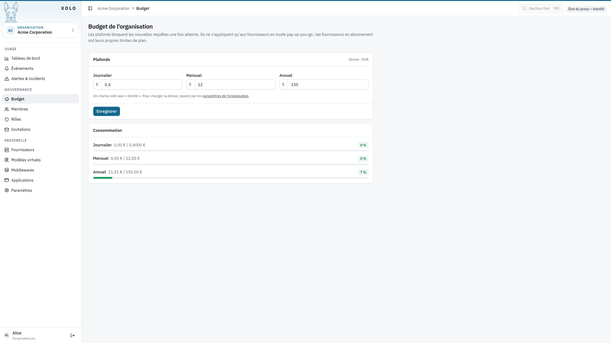
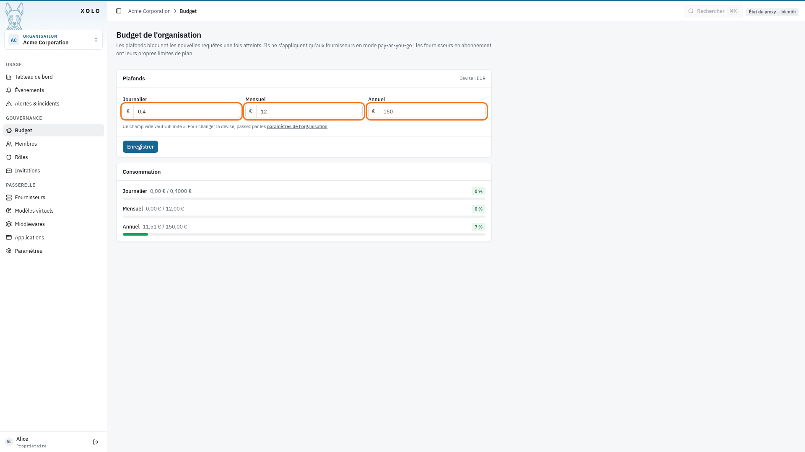

# Budget

## Qu'est-ce que le budget ?

Le budget vous permet de limiter les dépenses de l'organisation ou d'un membre en particulier (voir [la gestion du quotas par utilisateur](../membre/membre.md) ). Une fois le plafond atteint, les nouvelles requêtes API sont bloquées.

Les budgets s'appliquent uniquement aux fournisseurs en mode **Pay-as-you-go**. Les fournisseurs en mode abonnement disposent de leurs propres limites de plan.

## Accéder aux paramètres du budget

1. Rendez-vous dans votre organisation : `/orgs/{slug}/`
2. Cliquez sur **Budget** dans le menu latéral admin

> **Note** : Vous devez disposer de la permission `quota:write` pour modifier les budgets.

## Définir un budget pour l'organisation

1. Sur la page Budget, remplissez un ou plusieurs champs :
   - **Budget journalier** — limite quotidienne
   - **Budget mensuel** — limite mensuelle
   - **Budget annuel** — limite annuelle

2. Laissez un champ vide pour illimité.

3. Cliquez sur **Enregistrer**.

Les montants sont exprimés dans la devise de l'organisation (configurable dans les Paramètres).

La **Répartition entre les équipes** contraint les enveloppes des équipes à leur enregistrement : libre, plafonnée (chaque équipe au plus égale à l'organisation) ou partagée (la somme des équipes au plus égale à l'organisation). Un budget qui ne respecte pas la règle est refusé avec un message qui indique la période en cause.

## Hiérarchie des budgets

Les budgets fonctionnent à quatre niveaux :

| Niveau       | URL                                     | Description                     |
| ------------ | ---------------------------------------- | -------------------------------- |
| Organisation | `/orgs/{slug}/admin/quota`              | Budget global de l'organisation |
| Membre       | `/orgs/{slug}/admin/members/{id}/quota` | Budget individuel d'un membre   |
| Équipe       | `/orgs/{slug}/admin/teams/{id}`         | Enveloppe d'une équipe          |
| Membre dans une équipe | `/orgs/{slug}/admin/teams/{id}/members/{membershipID}` | Budget d'un membre dans une équipe |

Voir le tutoriel [Équipes](../equipes/equipes.md) pour les budgets d'équipe.

Xolo peut aussi répartir automatiquement le budget de l'organisation entre ses membres (option **Partager le budget équitablement**, dans les [Paramètres](../parametres/parametre.md)).

Pour le détail du calcul du budget effectif et du partage équitable, voir le concept [Budgets et quotas](../../../concepts/budgets-et-quotas.md).

## Suivre la consommation

La page Budget affiche la consommation actuelle avec des barres de progression :

- Montant dépensé vs budget maximum
- Pourcentage d'utilisation

## Permissions

| Action                | Permission requise |
| --------------------- | ------------------ |
| Consulter les budgets | `quota:read`       |
| Modifier les budgets  | `quota:write`      |

Ces permissions sont attribuables via les **Rôles** de l'organisation.
