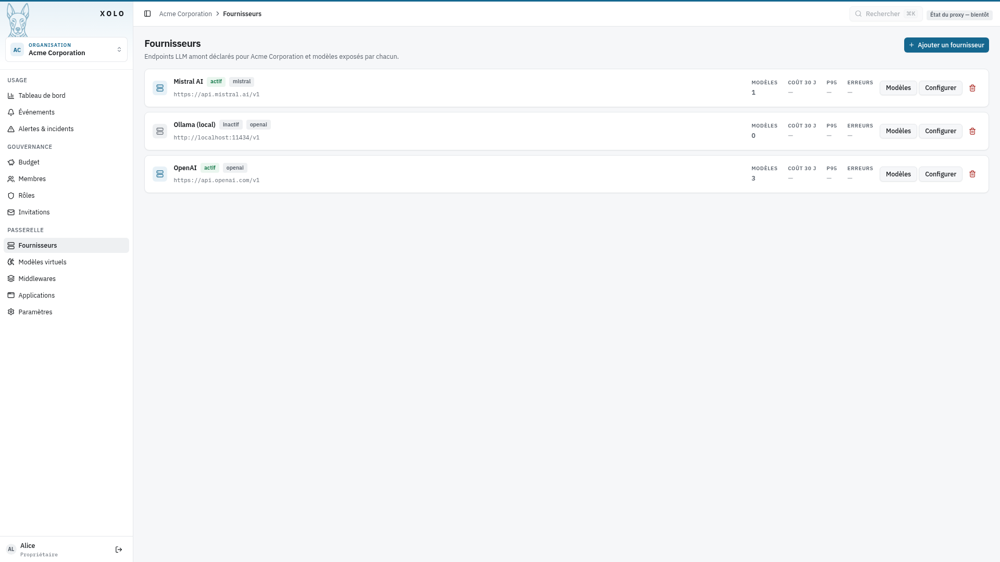
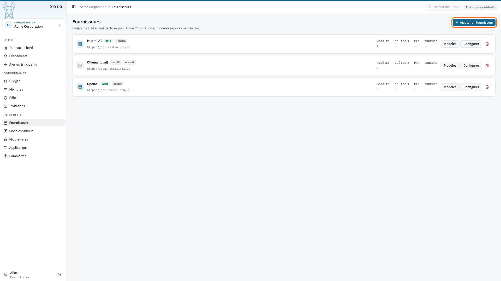
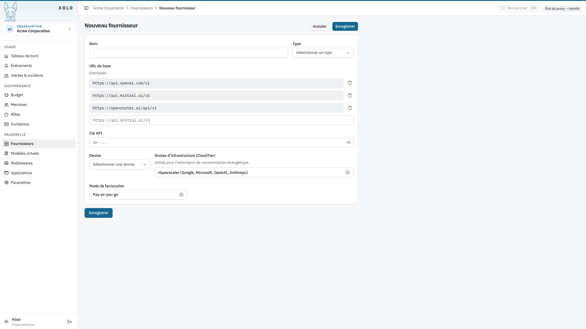
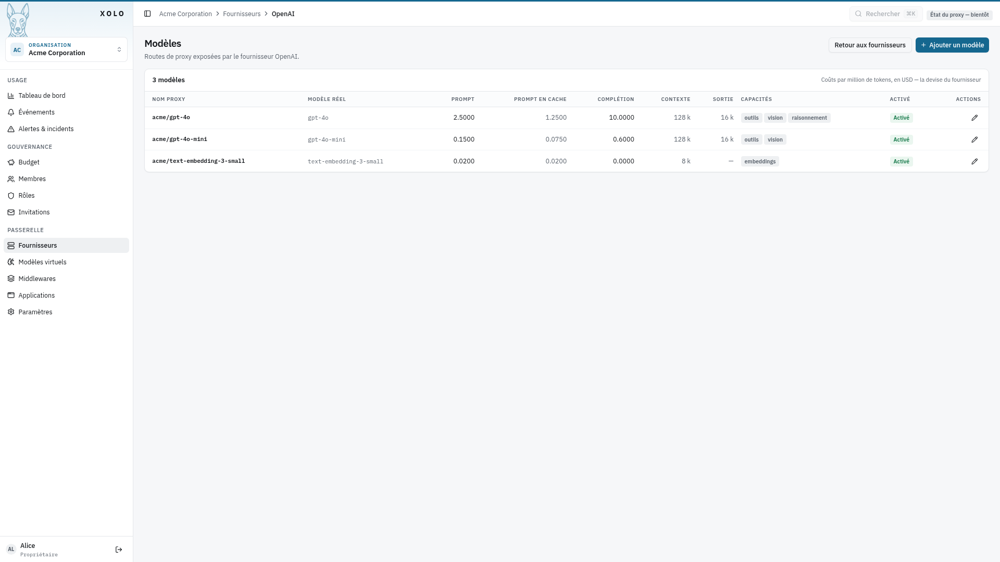
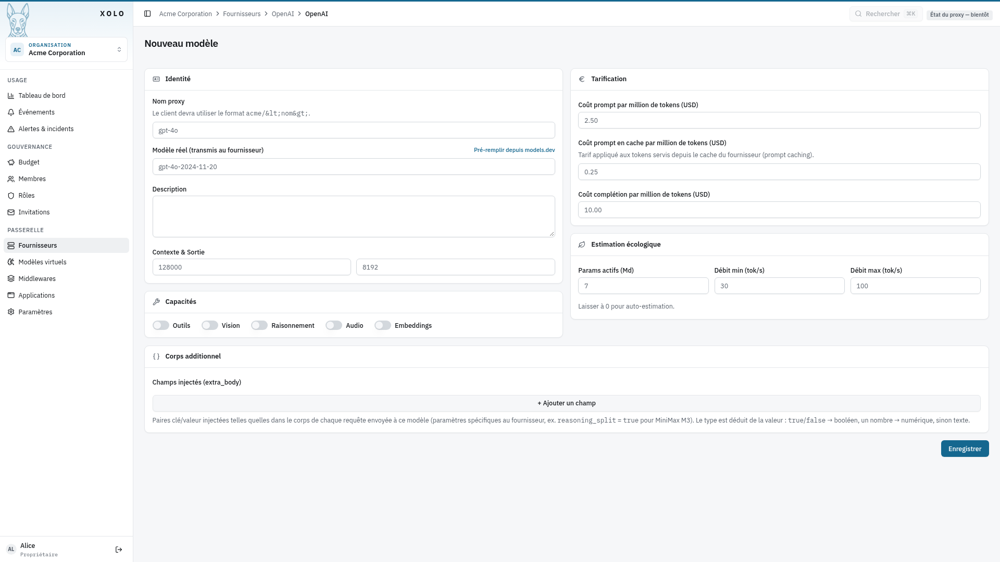
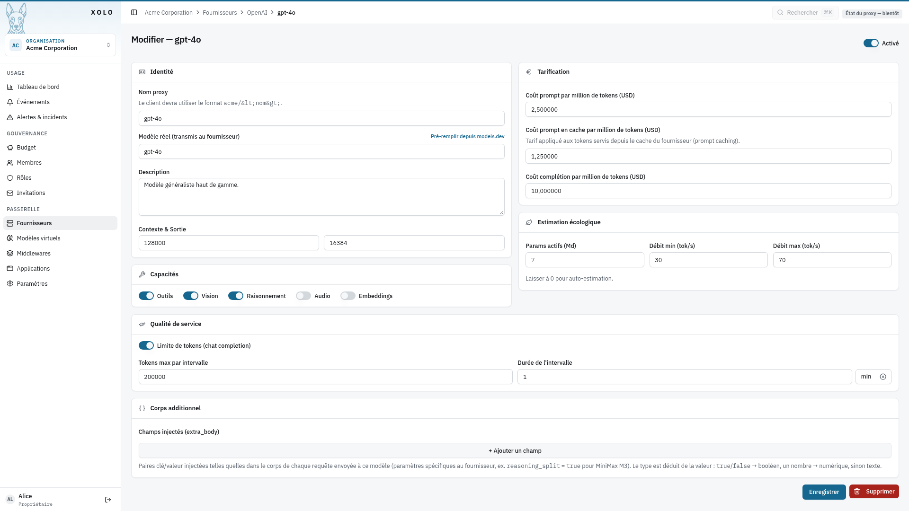
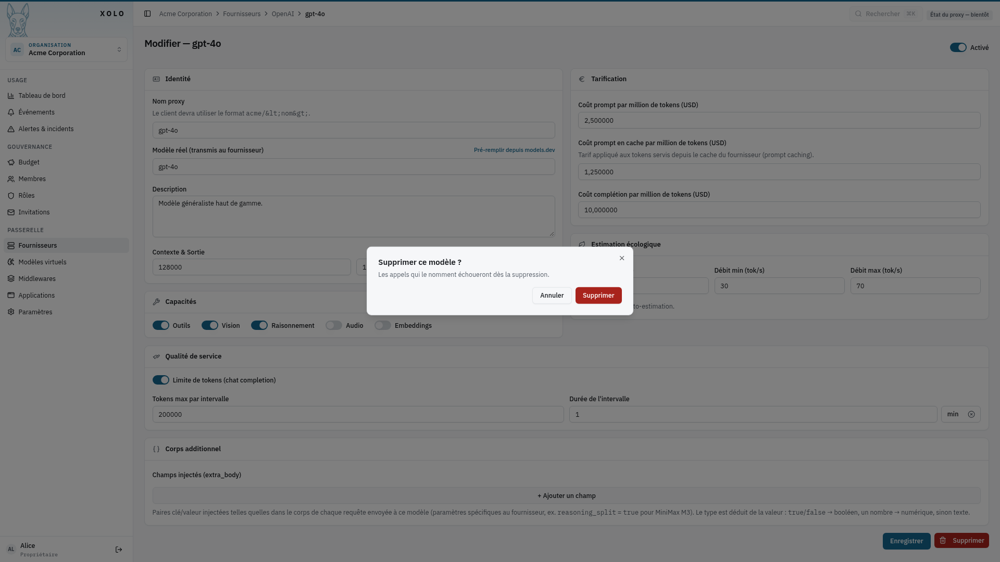

# Fournisseurs



## Qu'est-ce qu'un fournisseur ?

Un fournisseur est une connexion vers un service LLM externe (OpenAI, Mistral, OpenRouter, etc.). Il expose un ou plusieurs modèles que les utilisateurs de l'organisation peuvent consommer.

## Accéder aux fournisseurs

1. Allez dans votre organisation : `/orgs/{slug}/`
2. Cliquez sur **Fournisseurs** dans le menu admin

> **Note** : Vous devez disposer de la permission `providers:write` pour créer ou modifier des fournisseurs.

## Créer un fournisseur

1. Cliquez sur **Ajouter un fournisseur** (bouton en haut à droite)
   

2. Remplissez les informations du fournisseur :
   

   ### Champs du formulaire

   | Champ                       | Description                                                                                           |
   | --------------------------- | ----------------------------------------------------------------------------------------------------- |
   | **Nom**                     | Nom affiché du fournisseur                                                                            |
   | **Type**                    | Type de connexion : `openai`, `openai-responses`, `anthropic`, `gemini`, `mistral`, `openrouter`, `typesafe` |
   | **URL de base**             | URL de l'endpoint API (ex: `https://api.openai.com/v1`)                                               |
   | **Clé API**                 | Clé d'authentification auprès du fournisseur                                                          |
   | **Devise**                  | Devise pour la tarification (USD, EUR, etc.)                                                          |
   | **Niveau d'infrastructure** | Type d'hébergement (Hyperscaler, Major Cloud, Small Provider) — utilisé pour l'estimation énergétique |
   | **Mode de facturation**     | **Pay-as-you-go** : facturation à l'usage · **Abonnement** : plan à tokens                            |

3. Cliquez sur **Enregistrer**.

## Serveurs locaux : Ollama, vLLM et compatibles OpenAI

Xolo n'a pas de type de connexion propre à Ollama ou à vLLM, et n'en a pas besoin : ces serveurs exposent l'API au format OpenAI. Déclarez-les avec le type `openai` :

| Champ           | Ollama                                   | vLLM                                   |
| --------------- | ---------------------------------------- | -------------------------------------- |
| **Type**        | `openai`                                 | `openai`                               |
| **URL de base** | `http://localhost:11434/v1`              | `http://localhost:8000/v1`             |
| **Clé API**     | vide, sauf si vous en avez configuré une | celle passée à `--api-key`, sinon vide |

Adaptez l'hôte et le port à votre déploiement. Pour l'estimation énergétique, choisissez le niveau d'infrastructure **Small Provider** : c'est celui qui correspond le mieux à une machine que vous opérez vous-même. La même recette vaut pour tout serveur qui parle le format OpenAI (LM Studio, llama.cpp en mode serveur, LocalAI…).

## Anthropic : utilisez le type `anthropic`

Le type `anthropic` parle l'API Messages native d'Anthropic (`https://api.anthropic.com`), via le SDK officiel. C'est le type à choisir pour un compte Anthropic direct : il transmet les points de cache (`cache_control`) posés par les clients, rejoue les blocs de réflexion signés d'un tour à l'autre et remonte séparément les tokens lus et écrits dans le cache.

| Champ           | Anthropic                                                  |
| --------------- | ---------------------------------------------------------- |
| **Type**        | `anthropic`                                                |
| **URL de base** | `https://api.anthropic.com` (un suffixe `/v1` est toléré)  |
| **Clé API**     | votre clé `sk-ant-…`                                       |

Un fournisseur Anthropic déclaré avec le type `openai` sur l'endpoint compatible OpenAI continue de fonctionner, mais ce chemin ne transmet pas `cache_control` : les préfixes de prompt ne sont jamais mis en cache et sont facturés au tarif plein à chaque appel. Aucune migration automatique n'est faite ; modifiez le type du fournisseur à la main.

Pensez à renseigner le **coût du prompt en cache** sur les modèles concernés (chez Anthropic, environ 10 % du tarif d'entrée). Laissé vide, ce champ vaut le tarif plein : le coût affiché surestime alors la facture dès que le cache est actif. Les écritures de cache, facturées plus cher que le tarif d'entrée par Anthropic, sont comptées au tarif plein.

Le type `anthropic` envoie `max_tokens` à chaque requête, l'API l'exigeant : la valeur est celle du client, sinon la **fenêtre de sortie** du modèle telle que déclarée dans Xolo, plafonnée à 16 384 tokens. Ce plafond existe parce que, sur cette API, `max_tokens` dimensionne aussi le budget de réflexion (une fraction de `max_tokens` quand le client demande un niveau d'effort) et compte dans la fenêtre de contexte avec l'entrée. Un client qui veut davantage fixe lui-même `max_tokens`, et un client dont le prompt approche la fenêtre de contexte doit le faire aussi : sur cette API, entrée et `max_tokens` doivent tenir ensemble dans la fenêtre. Fenêtre de sortie non renseignée, le provider retombe sur 4096 tokens.

Vérifiez aussi l'**extra_body** des modèles migrés : ses entrées partent en champs de premier niveau de la requête, et l'API Messages n'accepte que les siens. Une clé propre au format OpenAI comme `reasoning_effort` fait échouer toutes les requêtes du modèle.

### Relais des requêtes Messages en streaming

Une requête `POST /api/v1/messages` avec `"stream": true` vers un modèle de type `anthropic` est **relayée** telle quelle au lieu d'être traduite : Xolo ne réécrit que le modèle, la clé et les champs **extra_body**, transmet les en-têtes `anthropic-*` du client (`anthropic-beta` compris) et renvoie les événements de l'amont sans les reconstruire. Les champs que Xolo ne connaît pas passent donc aussi, dans les deux sens. Un client peut ainsi activer toute fonctionnalité de l'API sur la clé du fournisseur, outils serveur compris (recherche web, serveurs MCP distants). Xolo ne comptabilise que les tokens : les frais facturés à la requête par Anthropic, comme la recherche web, n'apparaissent ni dans l'usage ni dans les quotas. C'est ce que demande Claude Code pour la vérification côté serveur du mode auto : sans le champ `safeguards` à l'aller et `safeguard_results` au retour, il refait lui-même cette vérification et la facture en tokens.

Authentification, quotas, suivi de l'usage et pseudonymisation s'appliquent comme sur une requête traduite. Les instructions système qu'un nœud ajoute en tête de conversation (pseudonymiseur, `system-prompt`) rejoignent le champ `system`, après celles du client. Le jeton Xolo du client n'est jamais transmis à l'amont. Un rejet de l'amont (statut, en-têtes comme `retry-after`, corps) revient au client sans modification.

La requête repasse par la traduction dans ces cas :

- requête sans `"stream": true` ;
- modèle virtuel dont le nœud terminal combine plusieurs modèles, comme un repli entre modèles ;
- modèle avec une **limite de tokens** : le limiteur de tokens ne sait pas compter une réponse relayée.

## Modèles de décision : TypeSafe

Un modèle de décision ne génère pas de texte. Il évalue un **état** (un texte, un objet JSON) au regard de **questions typées** et renvoie des probabilités calibrées :

- `noul` : une question fermée, dont la réponse est la probabilité du oui ;
- `choice` : un choix parmi les options que la question définit, avec la probabilité de chacune ;
- `score` : une position sur une échelle ordonnée de 2 à 10 niveaux.

Les modèles Jev de TypeSafe sont de ce genre. Déclarez-les avec le type `typesafe` et l'URL `https://api.typesafe.ai/v1`, ou par OpenRouter (type `openrouter`, modèle réel `~typesafe/jev-latest`), puis créez le modèle avec la nature **Décision**.

Les clients l'appellent sur `POST /api/v1/decisions`, au format de TypeSafe et du endpoint de décisions d'OpenRouter. Un client de l'un ou l'autre garde son format et pointe son URL d'endpoint vers cette route : le corps est le même, le chemin non.

```json
{
  "model": "{org-slug}/jev",
  "state": "Mes virements échouent depuis trois jours.",
  "questions": {
    "is_urgent": { "type": "noul", "instructions": "Ce ticket est-il urgent ?" },
    "team": {
      "type": "choice",
      "instructions": "Quelle équipe doit le traiter ?",
      "criteria": { "paiements": null, "recherche": "Recherche et catalogue" }
    }
  }
}
```

La réponse porte une réponse par question, sous le même identifiant, et l'usage en tokens (`input_tokens`, `output_tokens`). Xolo facture une décision comme une complétion : les tokens d'entrée au coût du prompt, ceux de sortie au coût de complétion, ou le coût que rapporte OpenRouter. Les quotas, l'abonnement, la limitation de débit et les nouvelles tentatives du fournisseur s'y appliquent aussi. L'**extra_body** et la limite de tokens d'un modèle ne visent que la complétion : sur un modèle de décision, ils sont ignorés.

Ni modèle virtuel ni middleware ne s'appliquent à une décision (voir [Nature du modèle](#nature-du-modele)).

## Tester la connexion

Après avoir créé un fournisseur, utilisez le bouton **Tester la connexion** pour vérifier que Xolo peut communiquer avec le fournisseur.

## Fournisseurs en abonnement : plan et répartition

Un fournisseur en mode **Abonnement** ne facture pas à l'usage : il vend un volume
global (des tokens, ou une valeur exprimée dans la devise du fournisseur) pour
toute l'organisation, sur une fenêtre qui se réinitialise. Le plan décrit ces
limites sous forme de **contraintes**.

### Contraintes

| Type                     | Champs                                           | Rôle                                                              |
| ------------------------ | ------------------------------------------------ | ----------------------------------------------------------------- |
| **Fenêtre glissante**    | Durée, budget tokens, budget valeur              | Volume consommable sur les N dernières heures                     |
| **Fenêtre fixe**         | Idem + « Reset dans »                            | Idem, mais alignée sur l'heure de réinitialisation du fournisseur |
| **Concurrence**          | Nombre max de requêtes simultanées               | Requêtes en vol autorisées en même temps                          |

Le champ « Reset dans » se recopie depuis l'écran du fournisseur (par exemple
`4h29m`) : Xolo le convertit en un ancrage absolu, de sorte que ses fenêtres
coïncident avec les réinitialisations réelles du forfait.

### Limites par modèle

Certains forfaits ne limitent pas le fournisseur dans son ensemble, mais chaque
modèle séparément. C'est le cas d'OpenCode Go : chaque modèle dispose de son
propre budget mensuel, dont 20 % sur 5 heures et 50 % sur une semaine. Cocher
**Décompter par modèle** sur une fenêtre lui donne ce comportement : chaque
modèle amont a sa propre fenêtre et ses propres budgets, et épuiser un modèle ne
bloque pas les autres.

Les budgets de la contrainte s'appliquent alors à chaque modèle. Le champ
**Budgets propres à certains modèles** les remplace pour les modèles qu'il
liste, un par ligne, sous leur nom amont (le « modèle réel ») :

```
kimi-k3 = 3
deepseek-v4.1-flash = 16, 50000000 tokens
longcat-2.5-preview-free = illimité
```

Une valeur s'exprime dans la devise du fournisseur, un budget tokens porte le
suffixe `tokens`, et `illimité` lève toute limite pour ce modèle. Un modèle listé
remplace les deux budgets de la contrainte : `kimi-k3 = 3` ne garde pas le
budget tokens de la contrainte pour `kimi-k3`.

Deux modèles Xolo qui pointent vers le même modèle amont, par exemple deux noms
publiés avec des réglages différents, sont décomptés ensemble, comme le fait le
fournisseur. Xolo garde ce regroupement 30 secondes : un modèle créé ou modifié
compte avec ses homonymes après ce délai. Si la liste des modèles ne peut pas
être lue, la requête est décomptée sur le seul modèle demandé, et le compteur
`xolo_plan_model_grouping_failures_total` s'incrémente. La répartition entre
utilisateurs s'applique modèle par modèle : un
utilisateur actif sur un modèle n'entame pas la part des autres modèles.

Un plan peut mêler les deux portées : une fenêtre décomptée par modèle et une
autre sur l'ensemble du fournisseur s'appliquent toutes les deux. Quand un plan
décompte par modèle et que le fournisseur répond `429`, seul le modèle demandé
est mis en pause, pour la durée indiquée par l'en-tête `Retry-After`, ou cinq
minutes à défaut.

Sur la page d'usage et le tableau de bord, une contrainte par modèle affiche une
jauge par modèle consommé dans la fenêtre en cours.

### Répartition entre utilisateurs

Le budget est commun, mais un utilisateur ne peut pas le consommer en entier. Sa
part se compose de deux termes :

- un **plancher garanti**, réparti à parts égales entre tous les membres de
  l'organisation, qu'ils consomment ou non : c'est ce qui protège un utilisateur
  occasionnel de ceux qui consomment beaucoup. C'est une réservation, non une
  simple part : la portion commune est plafonnée par ce qui reste réellement
  distribuable une fois les planchers des absents mis de côté, de sorte qu'un
  membre arrivant tard dans la fenêtre y retrouve bien sa part. Ce plancher vaut,
  par défaut, 30 % de l'ancienne part fixe `budget / membres` : il est plus bas
  que ce que l'ancienne règle garantissait, en échange d'une part nominale bien
  plus large dès que des membres restent inactifs. Relever la réserve remonte le
  plancher, mais reprend directement sur la portion commune ;
- le **reste du budget**, réparti entre les seuls utilisateurs **actifs dans la
  fenêtre**. Sur une organisation de vingt personnes dont trois utilisent
  réellement le forfait, chacune de ces trois dispose ainsi d'environ un quart du
  plan, au lieu d'un vingtième.

Deux mécanismes complètent cette répartition :

- le **rythme** : tant que la consommation globale reste en phase avec
  l'écoulement de la fenêtre, la part commune est pleinement ouverte ; si le
  forfait se consomme plus vite que la fenêtre ne s'écoule, les parts se
  resserrent progressivement vers le plancher garanti, puis se rouvrent quand la
  consommation rejoint son rythme ;
- l'**ouverture de fin de fenêtre** : dans les derniers instants avant la
  réinitialisation, le reliquat serait détruit ; il est alors réparti entre les
  utilisateurs actifs plutôt que réservé aux membres absents. Cette ouverture ne
  peut qu'élargir une part : si la répartition du reliquat donnait moins que la
  part courante, c'est la part courante qui s'applique.

Ces quatre réglages sont facultatifs et se trouvent sous « Répartition entre
utilisateurs » dans le formulaire de la contrainte. Laissés vides, ils prennent
leurs valeurs par défaut.

| Réglage                            | Défaut | Effet                                                                                        |
| ---------------------------------- | ------ | -------------------------------------------------------------------------------------------- |
| **Réserve garantie**               | 30 %   | Part du budget réservée à parts égales entre tous les membres                                 |
| **Tolérance de rythme**            | 15 %   | Avance de consommation tolérée avant que les parts ne se resserrent                           |
| **Ouverture de fin de fenêtre**    | 90 %   | Fraction de la fenêtre au-delà de laquelle le reliquat est réparti entre les actifs ; 100 désactive |
| **Avance maximale de l'ouverture** | 5 % de la fenêtre, entre 30 min et 4 h | Borne absolue de cette ouverture : 30 min avant le reset d'une fenêtre de 5 h, 4 h avant celui d'une fenêtre hebdomadaire |

Une valeur illisible ou hors bornes est refusée à l'enregistrement, avec un
message nommant la contrainte concernée : un réglage affiché doit être celui que
le moteur applique. L'ouverture de fin de fenêtre doit être strictement
supérieure à 0. C'est 100 qui la désactive.

La part d'un utilisateur dépend du nombre d'utilisateurs actifs au moment de la
requête : elle peut donc varier au cours d'une même fenêtre, à la hausse comme à
la baisse. Le tableau de bord affiche, sous chaque jauge d'abonnement, le nombre
d'utilisateurs actifs sur lequel la part a été calculée, ainsi qu'une mention
lorsque le rythme resserre la part, lorsque le forfait déjà consommé par les
autres la plafonne, ou lorsque la fin de fenêtre l'élargit.

## Configurer la résilience

Dans les paramètres avancés du fournisseur :

### Retry (nouvelles tentatives)

Permet de retenter automatiquement les requêtes échouées :

- **Nombre de tentatives** : combien de fois réessayer
- **Délai entre tentatives** : temps d'attente entre chaque essai (ms, s, min)

### Rate limit (limitation de débit)

Protection contre les surextensions :

- **Intervalle minimum** : temps minimal entre deux requêtes
- **Capacité de burst** : nombre max de requêtes simultanées autorisées

## En-têtes de requête

Certaines passerelles exigent des en-têtes que les SDK n'envoient pas. La section **En-têtes de requête** du formulaire du fournisseur, à la création comme à la modification, les configure :

- **En-tête de session** : nom de l'en-tête qui porte l'identifiant de la conversation. Xolo y place l'identifiant envoyé par le client : `X-Session-Id`, ou l'en-tête de Claude Code, de Codex ou d'OpenCode. À défaut, il calcule une empreinte de l'appelant (utilisateur, organisation, jeton) et du premier message de la conversation : elle reste la même d'un tour à l'autre et change d'une conversation à l'autre. Vide, aucun en-tête de session n'est envoyé.
- **En-têtes fixes** : ajoutés à chaque requête, ils remplacent ceux du client HTTP, `User-Agent` compris. Ce ne sont pas des secrets : seule la clé API est chiffrée. Une valeur vide est refusée, comme les en-têtes d'authentification (`Authorization`, `X-Api-Key`, `X-Goog-Api-Key`, `Cookie`), de transport (`Host`, `Content-Type`, `Content-Length`…) et de transfert (`Forwarded`, `X-Forwarded-For`…).

Ces en-têtes valent pour tous les modèles du fournisseur, quel que soit leur type d'API.

## Gestion des modèles

Chaque fournisseur peut exposer un ou plusieurs modèles.

### Accéder aux modèles

1. Depuis la liste des fournisseurs, cliquez sur **Modèles**
   

### Créer un modèle

1. Cliquez sur **Ajouter un modèle**
2. Remplissez les informations :
   

#### Champs d'identité

| Champ           | Description                                                          |
| --------------- | -------------------------------------------------------------------- |
| **Nom proxy**   | Nom visible par les utilisateurs (format : `{org-slug}/{nom-proxy}`) |
| **Modèle réel** | Nom exact du modèle chez le fournisseur                              |
| **Description** | Description optionnelle                                              |
| **Nature**      | Ce que le modèle sert : complétion, embeddings ou décision           |
| **Contexte**    | Taille de la fenêtre de contexte en tokens                           |
| **Sortie**      | Taille max de la réponse en tokens                                   |

#### Nature du modèle

Un modèle ne répond qu'aux routes de sa nature. Appelé sur une autre route, il répond `400` en indiquant la bonne.

| Nature         | Routes                                    | Types d'API qui la servent                                     |
| -------------- | ----------------------------------------- | -------------------------------------------------------------- |
| **Complétion** | `/chat/completions`, `/messages`          | tous sauf `typesafe`                                           |
| **Embeddings** | `/embeddings`                             | `openai`, `openai-responses`, `mistral`, `openrouter`          |
| **Décision**   | `/decisions`                              | `typesafe`, `openrouter`                                       |

Le formulaire refuse une nature que le type d'API du modèle ne sert pas. Un nouveau modèle est par défaut un modèle de complétion, sauf sur `typesafe`, qui ne sert que la décision.

Les modèles virtuels et les middlewares ne servent pour l'instant que la complétion. Un middleware « appliqué à tous les modèles » ne couvre que les modèles de complétion. Une requête d'embeddings ou de décision n'en traverse donc aucun, et son contenu n'est ni pseudonymisé ni filtré. Les sélecteurs de modèles des pipelines ne proposent que des modèles de complétion, et les plugins ne reçoivent que ceux-là dans leur liste de modèles. Un pipeline qui désigne malgré tout un modèle d'une autre nature répond `400` (code `model_kind_mismatch`) en nommant ce modèle.

Jusqu'à cette version, les embeddings étaient une capacité cochée sur un modèle de complétion. La mise à jour donne la nature embeddings à chaque modèle qui l'avait, si son type d'API sert les embeddings, puis retire la capacité. Sur un autre type d'API (`anthropic`, `gemini`), la capacité n'avait aucun effet : le modèle reste un modèle de complétion. Un modèle converti ne répond plus à `/chat/completions`, ni aux pipelines et plugins qui l'appelaient. S'il servait aussi la complétion, déclarez-le une seconde fois, sous un autre nom proxy, avec la nature complétion, et faites pointer ces pipelines vers ce nom. Les nœuds des pipelines existants ne sont pas migrés : un nœud `model_fallback` dont le premier candidat est devenu un modèle d'embeddings répond `400` sans essayer les suivants. Les modèles d'une organisation en attente de purge ne sont pas convertis : ils restent des modèles de complétion.

#### Champs de capacités

| Capacité         | Description                                 |
| ---------------- | ------------------------------------------- |
| **Outils**       | Le modèle peut utiliser des tools/functions |
| **Vision**       | Le modèle peut analyser des images          |
| **Raisonnement** | Le modèle utilise du chain-of-thought       |
| **Audio**        | Le modèle supporte l'audio                  |

#### Champs de tarification

| Champ                    | Description                                 |
| ------------------------ | ------------------------------------------- |
| **Coût prompt/1M**       | Prix par million de tokens en entrée        |
| **Coût prompt cache/1M** | Prix pour les tokens servis depuis le cache |
| **Coût complétion/1M**   | Prix par million de tokens en sortie        |

#### Champs d'estimation écologique

| Champ                  | Description                                 |
| ---------------------- | ------------------------------------------- |
| **Params actifs (Md)** | Nombre de paramètres du modèle en milliards |
| **Débit min/max**      | Vitesse de génération estimée (tokens/s)    |

#### Accès à l'API

| Champ           | Description                                                                         |
| --------------- | ----------------------------------------------------------------------------------- |
| **Type d'API**  | Type de connexion du modèle. Par défaut, celui du fournisseur                       |
| **URL de base** | URL de l'endpoint API du modèle. Vide, Xolo utilise l'URL de base du fournisseur    |

L'URL de base suit les mêmes règles que celle du fournisseur : URL `http` ou `https` absolue, sans identifiants, paramètres (`?…`) ni fragment (`#…`).

Ces deux champs servent aux fournisseurs qui exposent leurs modèles par plusieurs API. OpenCode Go en est un exemple : la plupart de ses modèles passent par l'API OpenAI, mais Qwen, MiniMax et Claude passent par l'API Messages d'Anthropic, sur une autre URL. Déclarez le fournisseur en `openai` avec l'URL `https://opencode.ai/inference/go/v1`. Elle sert aussi la liste des modèles (`/models`) dont l'import a besoin, contrairement à `https://opencode.ai/inference/go/openai/v1`. Réglez ensuite ces modèles ainsi :

| Champ           | Valeur                                         |
| --------------- | ---------------------------------------------- |
| **Type d'API**  | `anthropic`                                    |
| **URL de base** | `https://opencode.ai/inference/go/anthropic/v1` |

Le reste du fournisseur s'applique au modèle sans changement : clé API, devise, plan d'abonnement, retry et rate limit. Ce que la page dit du type `anthropic` (`max_tokens`, `extra_body`, relais en streaming) vaut pour un tel modèle comme pour un fournisseur de ce type.

Les modèles qu'OpenCode Go ne sert que par l'API Responses d'OpenAI (GPT, Grok) prennent le type `openai-responses`, sur l'URL du fournisseur. Ceux qu'il sert par l'API de Google (Gemini) prennent le type `gemini` :

| Champ           | Valeur                                          |
| --------------- | ----------------------------------------------- |
| **Type d'API**  | `gemini`                                        |
| **URL de base** | `https://opencode.ai/inference/go/google/v1beta` |

OpenCode Go refuse toute requête sans en-tête `x-opencode-session` et demande aux clients de s'identifier par leur `User-Agent`. Dans la section **En-têtes de requête** du fournisseur, renseignez `x-opencode-session` comme **En-tête de session** et ajoutez un en-tête fixe `User-Agent`, par exemple `xolo/1.0`. Les modèles marqués `contributor`, comme Gemini, exigent en plus d'accepter l'entraînement sur les requêtes dans les réglages de confidentialité du compte OpenCode.

> **Astuce** : Cliquez sur **Pré-remplir depuis models.dev** pour importer automatiquement les informations d'un modèle depuis le catalogue.

### Importer les modèles du fournisseur

Plutôt que de déclarer les modèles un par un, cliquez sur **Importer depuis le fournisseur** sur la page des modèles. Xolo interroge la liste des modèles du fournisseur avec sa clé API : `GET <URL de base>/models` pour les types `openai`, `openai-responses`, `gemini`, `mistral` et `openrouter`, `GET /v1/models` pour le type `anthropic`. La page affiche chaque modèle avec une case à cocher. Un modèle que le fournisseur sert déjà sous un autre nom proxy est grisé.

Le champ **Préfixe du nom proxy** est facultatif et ne peut pas contenir de `/`. Chaque modèle importé prend le nom `<préfixe><identifiant>` : avec le préfixe `go-`, le modèle `glm-5.3` s'appelle `{org-slug}/go-glm-5.3`. Un préfixe évite les conflits avec les modèles d'autres fournisseurs. La colonne **Nom proxy** suit le préfixe pendant la saisie et signale un nom déjà pris dans l'organisation, par un modèle ou par un modèle virtuel, ou lu comme le nom d'une équipe.

Les modèles importés :

- sont créés désactivés : saisissez leurs coûts avant de les activer, un modèle sans coût n'étant ni valorisé ni limité par les quotas ;
- ont un coût à zéro, la liste du fournisseur ne donnant pas de prix ;
- reprennent la fenêtre de contexte et la sortie maximale quand le fournisseur les indique (Anthropic, OpenRouter) ;
- utilisent le type d'API et l'URL du fournisseur. Un modèle servi par une autre API, comme Qwen chez OpenCode Go, se règle ensuite dans son formulaire (voir [Accès à l'API](#acces-a-lapi)).

Xolo relit la liste du fournisseur au moment de l'import. Un modèle qu'il ne liste plus, ou dont le nom proxy est déjà pris dans l'organisation (modèles désactivés et modèles virtuels compris), est laissé de côté, et la page indique pourquoi, comme pour un modèle que l'enregistrement n'a pas pu créer.

### Activer ou désactiver un modèle

Lors de l'édition d'un modèle, utilisez le commutateur **Activé** pour rendre le modèle accessible ou indisponible sans le supprimer.

### Supprimer un modèle

1. Ouvrez le modèle en modification
   
2. Cliquez sur **Supprimer**
   

## Supprimer un fournisseur

1. Allez dans la configuration du fournisseur
2. Cliquez sur **Supprimer le fournisseur**

> **Attention** : Cette action supprime également tous les modèles associés.

## Permissions

| Action                            | Permission requise |
| --------------------------------- | ------------------ |
| Consulter les fournisseurs        | `providers:read`   |
| Gérer les fournisseurs et modèles | `providers:write`  |
