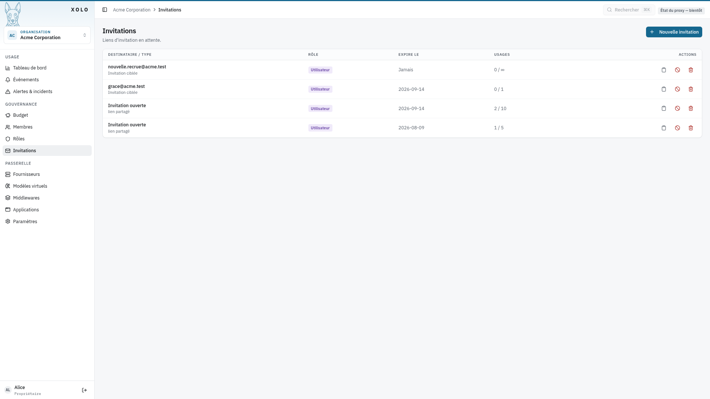
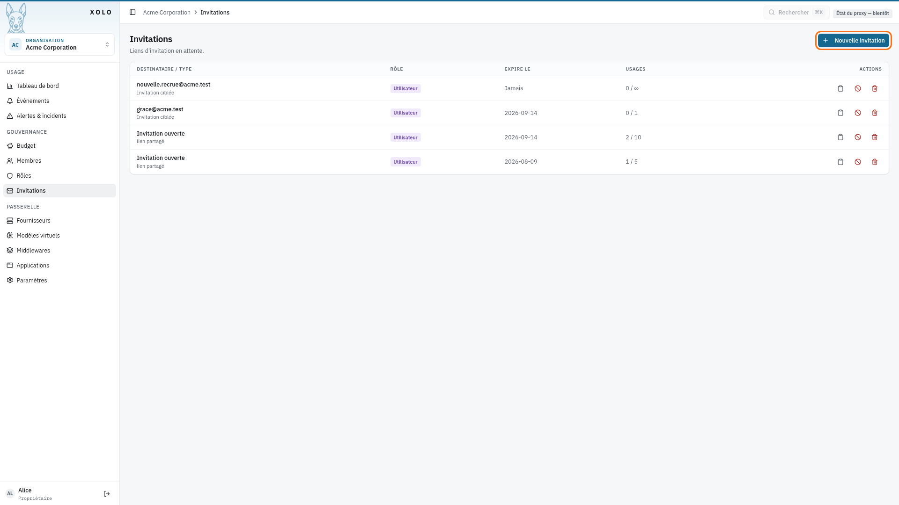
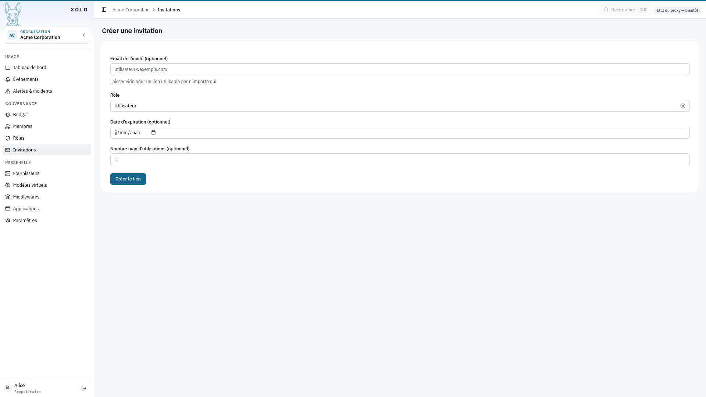
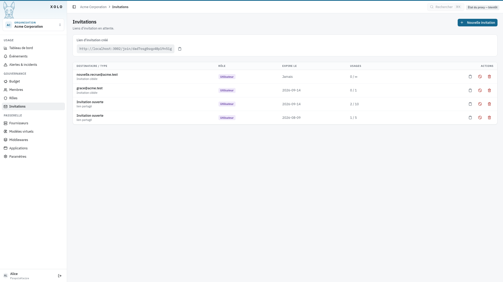
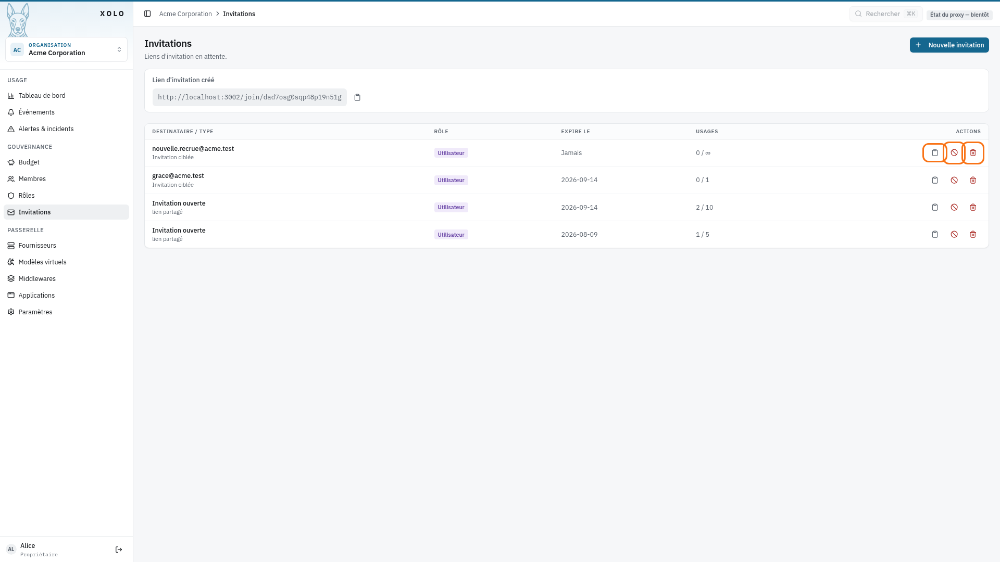

# Invitation des utilisateurs



## Qu'est-ce qu'une invitation ?

Une invitation est un lien qui permet à un utilisateur de rejoindre votre organisation. Le lien peut être :

- **Ciblé** : lié à une adresse email spécifique
- **Ouvert** : utilisable par n'importe qui

## Accéder aux invitations

1. Allez dans votre organisation : `/orgs/{slug}/`
2. Cliquez sur **Invitations** dans le menu admin

> **Note** : Vous devez disposer de la permission `invites:write` pour créer ou gérer des invitations.

## Créer une invitation

1. Cliquez sur **Nouvelle invitation** (bouton en haut à droite)
   

2. Remplissez les informations :
   

### Champs du formulaire

| Champ | Description |
|-------|-------------|
| **Email de l'invité** | Email du destinataire (optionnel — laisser vide pour un lien ouvert) |
| **Équipe** | Équipe que l'utilisateur rejoint en même temps que l'organisation (optionnel) |
| **Rôle** | Rôle attribué à l'utilisateur à son arrivée (Membre, Admin, etc.) |
| **Date d'expiration** | Date limite d'utilisation du lien (optionnel) |
| **Nombre max d'utilisations** | Limite d'utilisations du lien (optionnel) |

3. Cliquez sur **Créer le lien**.

4. Le lien d'invitation s'affiche — copiez-le et envoyez-le à l'utilisateur.
   

## Types d'invitations

### Invitation ciblée

Liez l'invitation à une adresse email. Seule la personne avec cet email pourra l'utiliser. La comparaison ignore la casse et les espaces autour de l'adresse : peu importe que vous saisissiez `Jean.Dupont@corp.tld` là où le fournisseur d'identité renvoie `jean.dupont@corp.tld`. L'adresse est d'ailleurs enregistrée en minuscules.

Le destinataire n'a pas besoin de posséder déjà un compte Xolo : une invitation ciblée en attente vaut pré-provisionnement, et le compte se crée à sa première connexion même lorsque `XOLO_HTTP_AUTHN_AUTO_CREATE_USERS` vaut `false`. Une invitation **ouverte** n'accorde pas cette dispense — elle ne nomme personne.

L'activation du compte, elle, reste réglée par `XOLO_HTTP_AUTHN_ACTIVE_BY_DEFAULT`. Un destinataire dont le compte est encore inactif peut malgré tout consulter, accepter ou décliner, depuis le lien reçu, une invitation ciblée qui lui est adressée. S'il l'accepte, il obtient son adhésion et son rôle immédiatement, mais le reste de l'instance lui indique que son compte est inactif jusqu'à ce qu'un administrateur l'active depuis `/admin/users`. Après un refus, il arrive sur cette même page. Une invitation **ouverte**, elle, exige un compte actif.

Xolo ne distingue pas un compte jamais activé d'un compte qu'un administrateur a désactivé : ce dernier peut lui aussi accepter une invitation ciblée qui lui est adressée. L'adhésion obtenue ne sert à rien tant que le compte reste inactif, mais elle prend effet dès sa réactivation. Révoquez les invitations en attente d'une personne dont vous désactivez le compte.

Une invitation ne vaut que dans le tenant de l'organisation qui l'a émise : elle n'apparaît pas, ne s'accepte pas et ne pré-provisionne rien depuis un autre tenant.

**L'adresse email vient du fournisseur d'identité.** Comme pour `XOLO_HTTP_AUTHN_DEFAULT_ADMINS`, Xolo se fie à l'adresse email que renvoie le fournisseur d'identité. Sur une instance qui expose plusieurs fournisseurs, quiconque obtient auprès de l'un d'eux une identité portant l'adresse invitée peut accepter l'invitation et devenir membre de l'organisation. Avec `XOLO_HTTP_AUTHN_ACTIVE_BY_DEFAULT=true`, il n'a même pas besoin du lien : l'invitation lui apparaît dans son espace. Avec `false`, il lui faut le lien, et son compte reste inutilisable tant qu'un administrateur ne l'a pas activé, mais son adhésion est acquise. N'activez que des fournisseurs qui vérifient les adresses qu'ils certifient.

### Invitation ouverte

Laissez le champ email vide. Le lien pourra être utilisé par n'importe qui — utile pour partager l'accès publiquement.

## Gérer les invitations



Pour chaque invitation, plusieurs actions sont disponibles :

| Action | Description |
|--------|-------------|
| **Copier le lien** | Copie l'URL d'invitation dans le presse-papiers |
| **Révoquer** | Invalide le lien immédiatement (l'utilisateur ne peut plus l'utiliser) |
| **Supprimer** | Supprime définitivement l'invitation de la liste |

### États d'une invitation

| État | Signification |
|------|---------------|
| Active | Le lien fonctionne normalement |
| Révoqué | Le lien a été invalidé manuellement |
| Expirée | La date d'expiration est dépassée |
| Épuisée | Le nombre max d'utilisations est atteint |

## Permissions

| Action | Permission requise |
|--------|-------------------|
| Consulter les invitations | `invites:read` |
| Créer, révoquer, supprimer | `invites:write` |

Ces permissions peuvent être détenues sur une [équipe](../equipes/equipes.md) seulement. Leur détenteur voit et gère les invitations de cette équipe, et ses invitations font rejoindre l'organisation avec le rôle Membre et l'équipe.

## Acceptation et refus

Une invitation est utilisable uniquement dans le tenant de son organisation.
Une invitation ciblée exige l'adresse e-mail indiquée, sans tenir compte de la
casse ni des espaces qui l'entourent ; ses détails sont masqués avant connexion.
Son destinataire peut l'accepter ou la refuser même si son compte est encore
inactif (voir [Invitation ciblée](#invitation-ciblee)). Une invitation ouverte
exige un compte actif. Une invitation ciblée est à usage unique et disparaît
après acceptation ou refus par son destinataire. Le refus d'un lien ouvert le
masque localement pendant un jour sans le supprimer.

Un membre déjà présent conserve ses rôles et ne consomme pas d'utilisation.
L'adhésion, l'attribution du rôle et la consommation du lien sont atomiques.
Le rôle choisi doit toujours exister dans l'organisation. Une date d'expiration
correspond à **minuit UTC au début de la date choisie** et doit être future.
Une limite doit être un entier strictement positif ; seul un champ vide signifie
« sans limite ». Pour une invitation ciblée, la limite enregistrée reste un.

## Préparer la mise à jour INV-01

Avant le déploiement, sauvegardez la base et suspendez les écritures pendant
les migrations. Contrôlez les doublons d'appartenance sur SQLite ou PostgreSQL :

```sql
SELECT user_id, org_id, COUNT(*) AS membership_count
FROM memberships
GROUP BY user_id, org_id
HAVING COUNT(*) > 1;
```

Si cette requête retourne des lignes, examinez les appartenances correspondantes
et leurs entrées `membership_roles`. Décidez explicitement quelles appartenances
et quels rôles conserver. La migration `202609300001` s'arrête avec les identifiants
des groupes en conflit (20 au maximum dans le diagnostic) ; elle ne fusionne ni
ne supprime aucune donnée. Après correction manuelle, relancez le démarrage pour
créer l'index unique `(user_id, org_id)`.

La migration `202609300002` révoque les anciens liens XID encore utilisables.
Ils restent visibles et supprimables dans l'administration, mais ne permettent
plus de rejoindre l'organisation. **Recréez et redistribuez tous les anciens
liens encore nécessaires après la mise à jour.** Les nouvelles invitations
utilisent des jetons de 256 bits générés avec `crypto/rand`, encodés en base64 URL
sans remplissage. Les routes restent identiques. La révocation n'est pas annulée
par un redémarrage et ne dispose pas de migration inverse.
