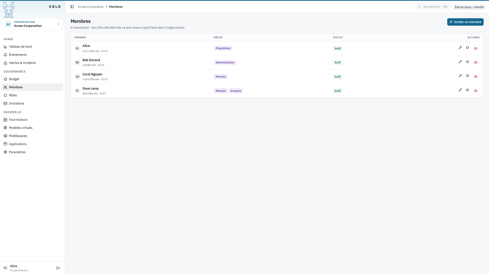
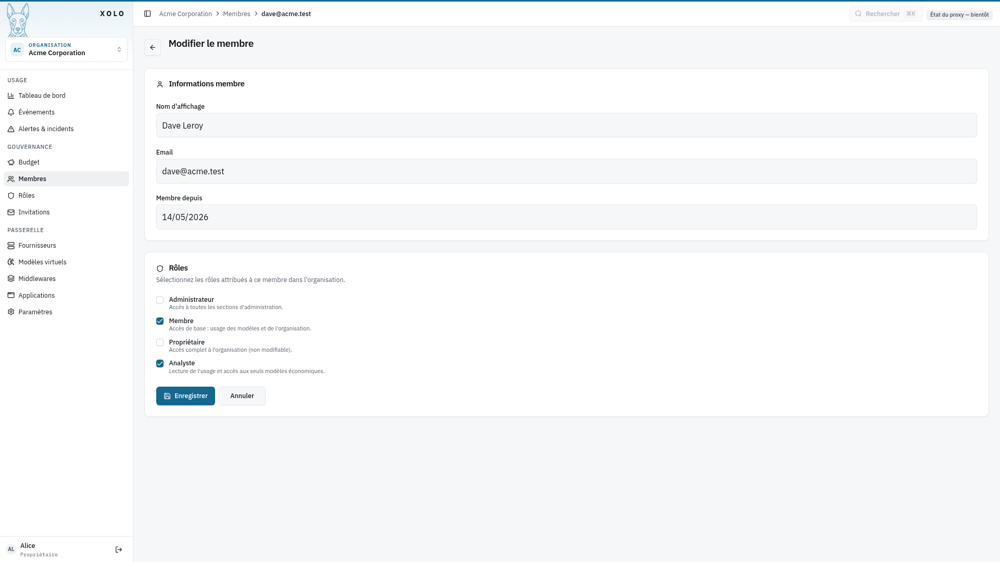

# Membres

## Qu'est-ce qu'un membre ?

Un membre est un utilisateur qui appartient à votre organisation. Chaque membre se voit attribuer un ou plusieurs rôles qui déterminent ses permissions d'accès.

## Accéder à la gestion des membres

1. Allez dans votre organisation : `/orgs/{slug}/`
2. Cliquez sur **Membres** dans le menu admin

> **Note** : Vous devez disposer de la permission `members:read` pour voir les membres, et `members:write` pour les modifier.

## Inviter un nouveau membre

Pour ajouter un membre, vous devez d'abord créer une invitation. Consultez le [tutoriel Invitations](../invitation/invitation.md). Pour éviter cette étape, une [règle d'inscription](../inscription/inscription.md) inscrit les identités qu'elle reconnaît dès leur connexion.

## Liste des membres

La liste des membres affiche pour chaque utilisateur :

- **Nom d'affichage**
- **Email**
- **Rôle(s)** attribués
- **Statut** : Actif ou Inactif

## Actions disponibles

Pour chaque membre, trois actions sont disponibles :

| Action       | Icône              | Description                           |
| ------------ | ------------------ | ------------------------------------- |
| **Modifier** | Crayon             | Modifier les rôles du membre          |
| **Quota**    | Tirelire           | Définir un budget individuel          |
| **Retirer**  | Utilisateur avec X | Supprimer le membre de l'organisation |

## Modifier les rôles d'un membre

### Accéder au formulaire

Cliquez sur l'icône **Modifier** (crayon) sur la ligne du membre concerné.

### Informations du membre

Le formulaire affiche les informations du membre (informations read-only) :

- Nom d'affichage
- Email
- Date d'adhésion

### Attribuer des rôles

Le formulaire présente tous les rôles disponibles dans l'organisation sous forme de cases à cocher :

| Rôle intégré | Description                                        |
| ------------ | -------------------------------------------------- |
| **Membre**   | Accès de base à l'organisation                     |
| **Admin**    | Accès complet à l'administration de l'organisation |

Des rôles personnalisés peuvent également être créés (voir le tutoriel Rôles).

### Enregistrer

Cliquez sur **Enregistrer** pour appliquer les modifications, ou **Annuler** pour revenir sans rien modifier.

## Définir un budget individuel

Chaque membre peut disposer d'un budget personnel qui s'ajoute ou se limite au budget de l'organisation.

Cliquez sur l'icône **Quota** (tirelire) pour accéder aux paramètres de budget du membre.

Pour plus de détails, consultez le [tutoriel Budget](../budget/budget.md).

## Retirer un membre

Cliquez sur l'icône **Retirer** (utilisateur avec X) pour supprimer un membre de l'organisation.

> **Attention** : Cette action est irréversible. L'utilisateur devra être réinvité pour rejoindre l'organisation.

## Permissions

| Action                        | Permission requise |
| ----------------------------- | ------------------ |
| Consulter les membres         | `members:read`     |
| Modifier les rôles ou retirer | `members:write`    |
| Gérer les budgets individuels | `quota:write`      |
