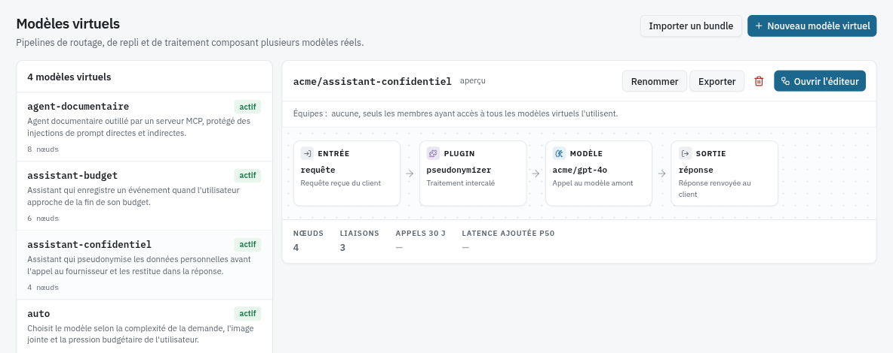
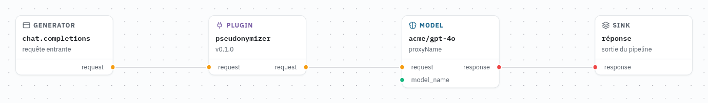
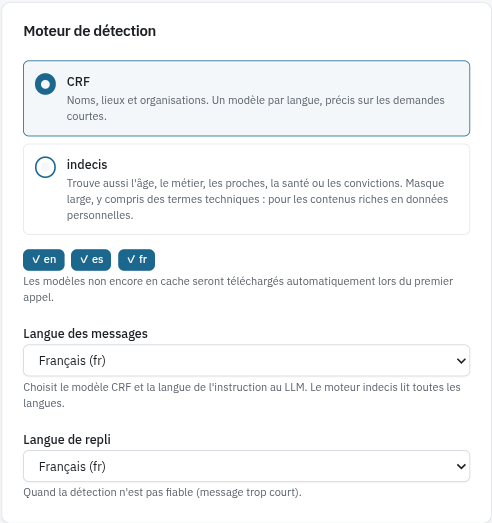
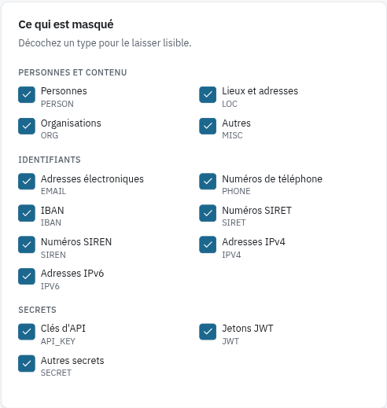
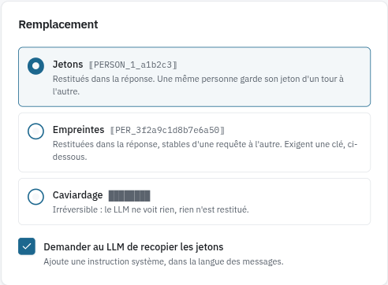
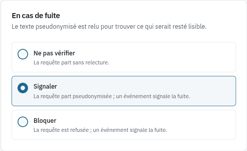
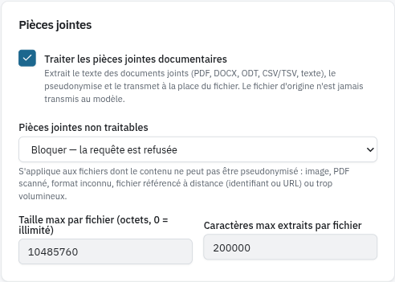
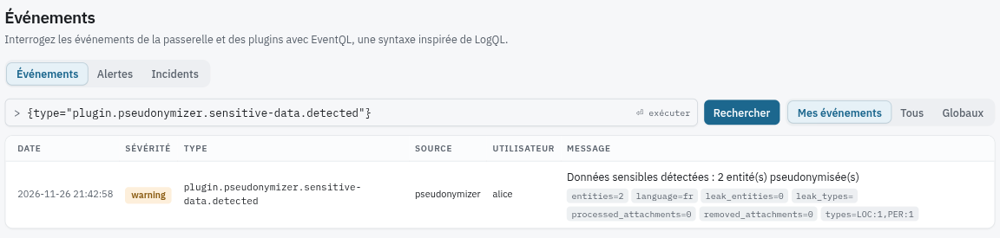

# Guide : protéger les données personnelles

Ce guide construit un modèle virtuel `acme/assistant-confidentiel` qui remplace les données personnelles par des jetons avant l'appel au fournisseur, puis rétablit les valeurs d'origine dans la réponse. L'utilisateur écrit et lit des noms en clair ; le fournisseur ne voit que `⟦PERSON_1_a3f9c2⟧` ou `⟦LOCATION_1_a3f9c2⟧`.

Le fichier [`assistant-confidentiel.bundle.json`](./assistant-confidentiel.bundle.json){ download="assistant-confidentiel.bundle.json" } contient le résultat final : téléchargez-le, puis chargez-le avec le bouton **Importer un bundle** de la page Modèles virtuels. Vérifiez ensuite que le modèle appelé, `acme/gpt-4o`, existe dans votre organisation : l'import ne contrôle pas les noms de modèles, et un nom absent échoue à la première requête.



## Prérequis

- Une organisation dont vous êtes administrateur, avec la permission d'écrire les modèles virtuels.
- Un fournisseur actif et un modèle déclaré dessus. Ce guide l'appelle `acme/gpt-4o`.
- Le plugin `pseudonymizer` chargé sur le serveur. Il apparaît dans la palette de l'éditeur, section **Plugins**. Son modèle de reconnaissance d'entités se télécharge au premier appel : sur un serveur sans accès à Internet, voir le mode hors-ligne dans la [référence du plugin](../reference/noeuds/plugins/pseudonymizer.md).

La création d'un modèle virtuel et la prise en main de l'éditeur sont décrites dans [Modèle virtuel](../organisation/modeles-virtuels.md).

## Étape 1 : le modèle virtuel

Un modèle virtuel se présente aux clients comme un modèle ordinaire : ils l'appellent par son nom, sans rien changer à leur code. La pseudonymisation s'applique ainsi à toutes les requêtes, sans dépendre de la vigilance de chaque utilisateur.

Dans **Passerelle › Modèles virtuels**, créez un modèle virtuel nommé `assistant-confidentiel`, puis ouvrez son éditeur. Il ne contient que les nœuds `generator` et `sink`.

Ajoutez le plugin `pseudonymizer` et le nœud intégré `model`, puis tracez le chemin de la requête : `generator.request` vers `pseudonymizer.request`, `pseudonymizer.request` vers `model.request`, `model.response` vers `sink.response`. Dans l'inspecteur du nœud `model`, choisissez `acme/gpt-4o`.



Le plugin est sur le chemin de la requête : il transforme les messages qui le traversent, et le modèle reçoit les messages pseudonymisés. Au retour, il restitue les valeurs d'origine dans la réponse, sans liaison supplémentaire.

## Étape 2 : choisir le moteur

Avant de remplacer une donnée, il faut la trouver. Le moteur de détection décide de ce qui est reconnu comme personnel. S'il détecte trop peu, des noms partent en clair. S'il détecte trop, il masque des mots dont le modèle a besoin pour répondre. Le bon choix dépend de ce que les utilisateurs enverront.

Sélectionnez le nœud `pseudonymizer`. Son écran de configuration s'ouvre dans le panneau de droite et présente les réglages dans l'ordre que suit ce guide.

Sous **Moteur de détection**, deux choix :

| Moteur | Ce qu'il trouve | Quand le choisir |
| --- | --- | --- |
| **CRF** | Personnes, lieux, organisations, avec un modèle par langue (français, anglais, espagnol) | Un assistant généraliste : il reste précis sur les demandes courtes et laisse lisibles les termes techniques |
| **indecis** | En plus : âge, métier, proches, santé, convictions, numéros de dossier, dates | Des contenus riches en données personnelles : comptes rendus, courriers, dossiers médicaux ou RH |

`indecis` masque beaucoup. Dans « Explique la différence entre TCP et UDP », il masque `TCP` et `UDP`, ce qui dégrade une réponse technique. Pour ce guide, gardez **CRF**. Le choix d'`indecis` et le réglage de sa prudence sont détaillés dans la [référence du plugin](../reference/noeuds/plugins/pseudonymizer.md#moteur-de-detection).

Réglez **Langue des messages** sur **Français**. En détection automatique, le plugin détermine la langue à chaque requête. La fixer évite qu'une demande courte, mêlée d'anglais, soit analysée avec le mauvais modèle.



## Étape 3 : choisir ce qui est masqué

Tout masquer n'est pas toujours souhaitable : une donnée masquée est une information que le modèle ne peut plus utiliser. Cette étape règle, type par type, le compromis entre protection et utilité.

La section **Ce qui est masqué** liste chaque type de donnée avec sa case, en trois groupes :

- **Personnes et contenu** : personnes, lieux et adresses, organisations, et les autres types du moteur ;
- **Identifiants** : adresses électroniques, numéros de téléphone, IBAN, SIRET, SIREN, adresses IP ;
- **Secrets** : clés d'API, jetons JWT, autres secrets.

Décochez un type pour le laisser lisible. Un assistant de prise de rendez-vous peut par exemple garder les lieux en clair, pour que le modèle sache de quelle ville il parle, et masquer tout le reste.



Les secrets ne sont pas pseudonymisés mais caviardés : le marqueur `⟦…_REDACTED⟧` remplace la valeur, sans correspondance pour la restituer. Si un agent lit un fichier qui contient une clé puis le réécrit, le marqueur se retrouve dans le fichier à la place de la clé. Décochez les secrets sur un modèle virtuel destiné à des agents qui modifient des fichiers de configuration.

## Étape 4 : choisir le remplacement

Une fois la donnée trouvée, reste à décider ce qui la remplace. Ce choix détermine si l'utilisateur retrouvera la valeur d'origine dans la réponse, et si le modèle pourra suivre une même personne d'un message à l'autre.

Sous **Remplacement** :

| Choix | Ce que voit le fournisseur | Restitué dans la réponse |
| --- | --- | --- |
| **Jetons** | `⟦PERSON_1_a3f9c2⟧`, un numéro par personne, stable d'un tour à l'autre | Oui |
| **Empreintes** | Une empreinte de la valeur, stable d'une requête à l'autre. Exige une clé HMAC, enregistrée dans les secrets du nœud | Oui |
| **Caviardage** | Rien : la valeur est retirée | Non |

Choisissez **Jetons**. Une même personne garde son jeton d'un tour à l'autre, si bien que le préfixe de la conversation ne change pas et que le cache de prompt du fournisseur continue de servir. Le suffixe du jeton est dérivé de l'organisation, de l'utilisateur et du nœud : il ne révèle rien au fournisseur que la clé d'API ne lui dise déjà.

Laissez cochée **Demander au LLM de recopier les jetons** : le plugin ajoute une consigne qui demande au modèle de recopier les jetons tels quels, faute de quoi il les reformule parfois et la restitution échoue.



## Étape 5 : choisir la conduite en cas de fuite

Aucun moteur ne trouve tout : un nom rare ou une adresse mal orthographiée peuvent passer. Une relecture après remplacement repère ce qui a échappé. Cette étape décide de la suite : signaler la fuite, ou refuser la requête.

Sous **En cas de fuite** :

- **Ne pas vérifier** : la requête part sans relecture.
- **Signaler** : la requête part pseudonymisée, et un événement `plugin.pseudonymizer.sensitive-data.leak` signale ce qui a échappé au remplacement.
- **Bloquer** : la requête est refusée, et le même événement le signale.

Commencez par **Signaler**. Les événements des premières semaines montrent quels types échappent au moteur sur vos données réelles. Passez à **Bloquer** quand ils deviennent rares, ou d'emblée si une fuite est inacceptable pour ce modèle virtuel.



## Étape 6 : les pièces jointes

Une donnée personnelle ne se trouve pas toujours dans le texte du message : un contrat, un relevé ou une capture d'écran en contiennent autant. Sans règle pour les pièces jointes, le message serait protégé et le document joint partirait en clair.

Sous **Pièces jointes**, **Traiter les pièces jointes documentaires** extrait le texte des documents joints (PDF, DOCX, ODT, CSV, texte), le pseudonymise et le transmet à la place du fichier. Reste le cas des fichiers dont le contenu ne peut pas être pseudonymisé : une image, un PDF scanné, un format inconnu. Le réglage **Pièces jointes non traitables** décide de ce qu'il en advient :

- **Bloquer** refuse la requête ;
- **Retirer** écarte la pièce jointe et laisse passer la requête.

Gardez **Bloquer** : une capture d'écran qui montre un nom partirait sinon en clair, ou disparaîtrait sans que l'utilisateur comprenne pourquoi le modèle ne la voit pas.



Enregistrez la configuration du nœud, puis le pipeline. Le bandeau du bas indique **Graphe valide**.

## Étape 7 : tester

Une configuration se vérifie sur une vraie requête : c'est le seul moyen de constater que le fournisseur ne voit que des jetons et que l'utilisateur retrouve ses noms. C'est aussi le moment de poser les alertes qui préviendront si la protection cesse un jour de fonctionner.

Avec un jeton d'API de l'organisation, envoyez une demande qui cite une personne et une ville :

```bash
curl -s http://localhost:3002/api/v1/chat/completions \
  -H "Authorization: Bearer $XOLO_TOKEN" -H 'Content-Type: application/json' \
  -d '{"model":"acme/assistant-confidentiel","messages":[{"role":"user","content":"Rédige un courriel de relance à Jean Dupont, notre client de Lyon, pour sa facture impayée."}]}'
```

La réponse parle de Jean Dupont et de Lyon : le plugin a restitué les noms. Le fournisseur, lui, a reçu `⟦PERSON_1_…⟧` et `⟦LOCATION_1_…⟧`.

La page **Événements** de l'organisation le confirme. Chaque requête où quelque chose a été remplacé produit un événement `plugin.pseudonymizer.sensitive-data.detected` dont l'attribut `types` compte ce qui a été remplacé, par exemple `LOC:1,PER:1`. Une demande sans donnée personnelle part telle quelle, sans événement.



La restitution suppose que le modèle recopie les jetons tels quels, crochets compris. Faites cet essai avec le modèle que vous comptez utiliser, pas avec un autre : un petit modèle local les déforme. Essayé avec `qwen2.5:3b` sur Ollama, il a écrit `[Prénom_PERSON_267830_3dbaa6]` ou `LOCATION_263704_3dbaa6` sans crochets, et même en caractères pleine chasse ; aucun de ces jetons n'a pu être restitué, et la réponse ne nommait ni Jean Dupont ni Lyon. Aucun événement ne signale ce cas : seule la lecture des réponses le révèle.

Deux alertes [EventQL](../reference/eventql.md) méritent d'être posées dès la mise en service :

| Requête | Ce qu'elle signale |
| --- | --- |
| `{type="plugin.pseudonymizer.sensitive-data.leak"}` | Une donnée a échappé au remplacement |
| `{type="plugin.pseudonymizer.passthrough"}` | Une requête est partie **sans** pseudonymisation : modèle de reconnaissance indisponible, configuration invalide, échec d'anonymisation |

La seconde est la plus importante : un serveur qui n'a pas pu télécharger son modèle laisse passer les requêtes en clair, et cet événement en est le seul signal.

## Ce qu'il faut savoir

- **Le modèle doit savoir recopier les jetons.** Voir l'étape 7 : un modèle qui les reformule rend une réponse où les personnes ne sont plus nommées.
- **La réponse n'est plus streamée.** Dès que le plugin a remplacé quelque chose, Xolo attend la fin de la réponse pour y restituer les valeurs avant de la renvoyer. Le client reçoit la réponse d'un bloc.
- **Le prompt système de premier niveau de la route Messages n'est pas pseudonymisé.** Il voyage dans le champ `system` de la requête, hors des messages que le pipeline traite. Un client qui y écrit un nom l'envoie en clair.
- **Un nœud qui appelle un modèle doit lire les messages pseudonymisés.** Un `llm-classifier` branché sur `generator.request` enverrait les noms en clair au modèle qu'il interroge. Branchez-le sur la sortie `request` du `pseudonymizer`.
- **Aucune correspondance n'est conservée au-delà de la requête.** Xolo n'écrit les valeurs d'origine nulle part. Elles ne figurent que dans les messages du client, qu'il renvoie à chaque tour.

## Pour aller plus loin

- **Protéger tous les modèles d'un coup.** Le même graphe, avec la case **Passthrough** cochée sur le nœud `model`, devient un [middleware](../organisation/middlewares.md) qui s'applique à chaque modèle de l'organisation, sans que les clients changent de nom de modèle.
- **Un agent outillé.** Le plugin restitue aussi les jetons dans les arguments des appels d'outils que le modèle émet. Le [guide de l'agent outillé](./agent-outille.md) construit un tel agent.
- **Tout le détail du plugin**, formats d'outils, raisonnement étendu, mode strict, est dans sa [référence](../reference/noeuds/plugins/pseudonymizer.md).
