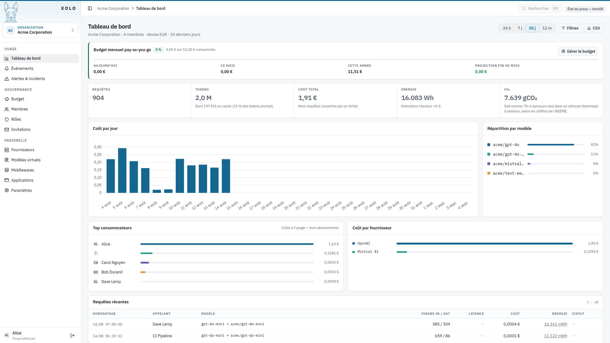

# Bienvenue dans Xolo

Xolo est une passerelle LLM souveraine pour l'entreprise. Elle se place entre vos applications et les fournisseurs de modèles : elle tient les clés d'API, applique les budgets, route les requêtes et garde une trace de chacune.

## Par où commencer

Vous découvrez Xolo ? Suivez ces trois pages dans l'ordre.

1. **[Découvrir](./decouvrir/index.md)**. Ce que fait Xolo et les six notions à connaître.
2. **[Premiers pas](./premiers-pas/index.md)**. Une instance, un fournisseur, un jeton, une première requête.
3. **[Guides](./guides/index.md)**. Quatre modèles virtuels construits pas à pas, chacun autour d'un cas d'usage.

## Comment est organisée cette documentation

| Section | Pour qui ? | Contenu |
| --- | --- | --- |
| **[Découvrir](./decouvrir/index.md)** | Tous | Les principes de Xolo : organisation et permissions, fournisseurs et pipelines, budgets, estimation énergétique |
| **[Premiers pas](./premiers-pas/index.md)** | Qui installe Xolo pour l'essayer | Le parcours complet, de l'installation à la première requête |
| **[Utiliser](./utilisation/index.md)** | Les membres d'une organisation | Le tableau de bord, les événements et les alertes |
| **[Administrer une organisation](./organisation/index.md)** | Les administrateurs d'une organisation | Membres, rôles, équipes, fournisseurs, budgets, applications, modèles virtuels, middlewares |
| **[Guides](./guides/index.md)** | Les administrateurs d'une organisation | Des modèles virtuels complets, avec leur pipeline à importer |
| **[Exploiter l'instance](./exploitation/index.md)** | Les personnes qui hébergent Xolo | Installation, configuration, mises à niveau, API de provisioning, obligations de l'AGPL |
| **[Référence](./reference/index.md)** | Tous, pour chercher un détail | Les nœuds de pipeline, les plugins livrés, la syntaxe EventQL, et [l'écriture d'un plugin](./developpement/plugins.md) |
| **[Projet](./projet/communaute.md)** | Les contributeurs | Communauté, contribution, gouvernance, marque, sécurité |
