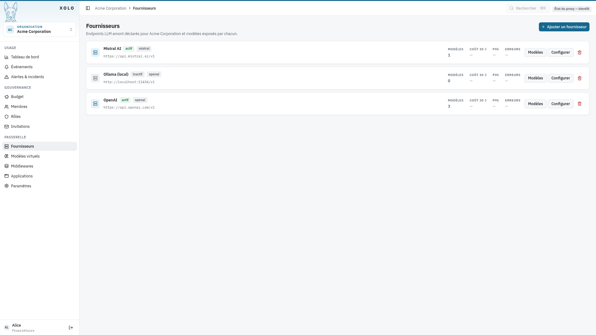
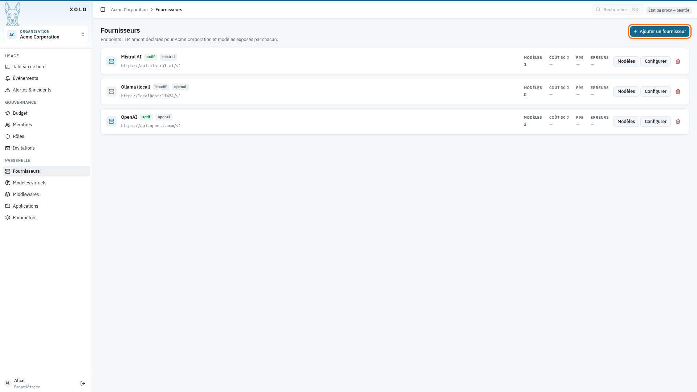
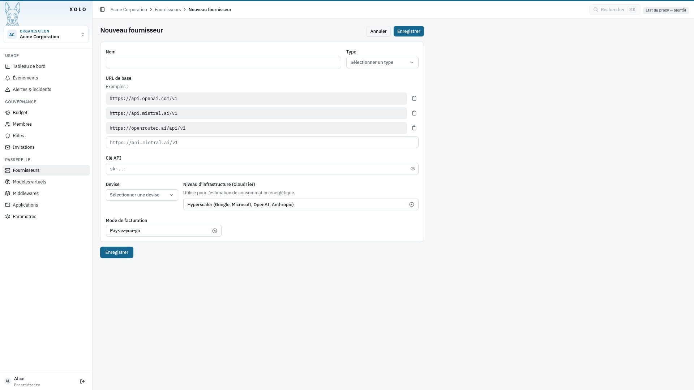
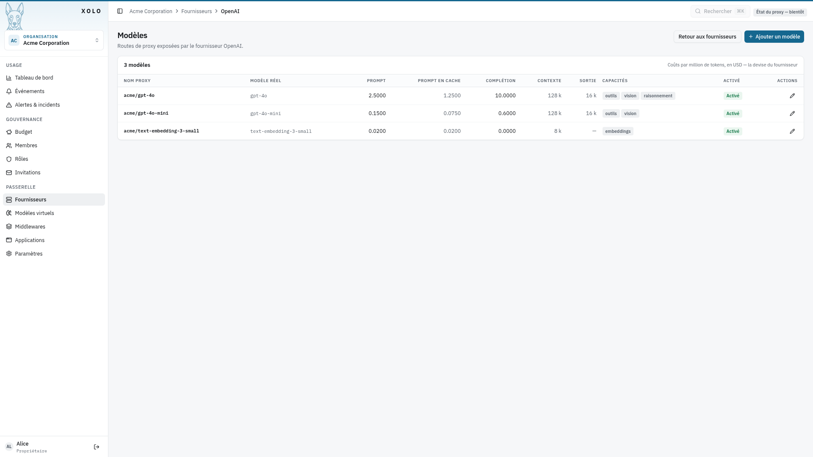
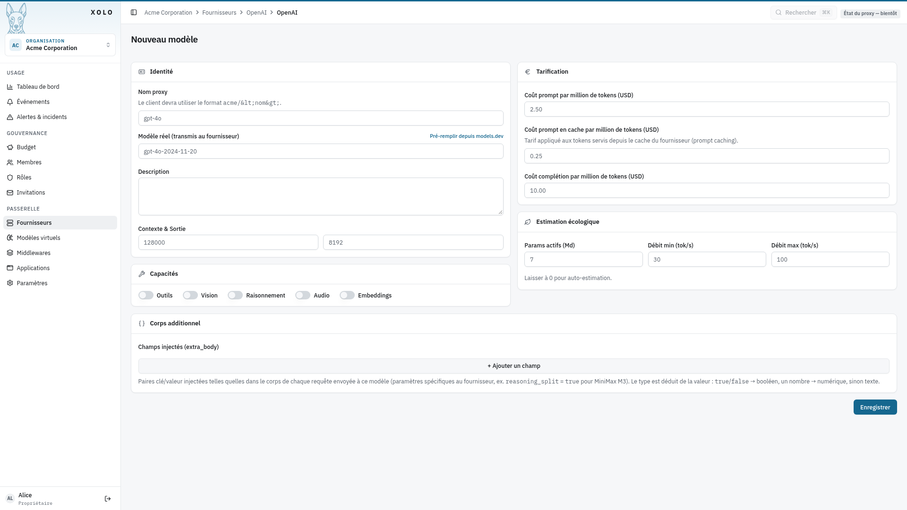
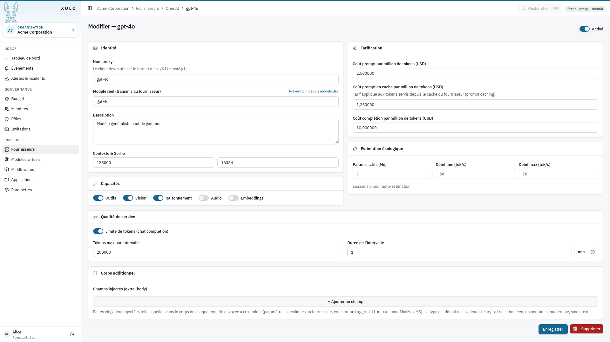
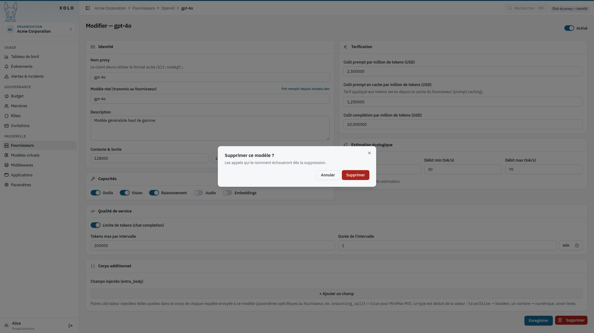

# Fournisseurs



## Qu'est-ce qu'un fournisseur ?

Un fournisseur est une connexion vers un service LLM externe (OpenAI, Mistral, OpenRouter, etc.). Il expose un ou plusieurs modèles que les utilisateurs de l'organisation peuvent consommer.

## Accéder aux fournisseurs

1. Allez dans votre organisation : `/orgs/{slug}/`
2. Cliquez sur **Fournisseurs** dans le menu admin

> **Note** : Vous devez disposer de la permission `providers:write` pour créer ou modifier des fournisseurs.

## Créer un fournisseur

1. Cliquez sur **Ajouter un fournisseur** (bouton en haut à droite)
   

2. Remplissez les informations du fournisseur :
   

   ### Champs du formulaire

   | Champ                       | Description                                                                                           |
   | --------------------------- | ----------------------------------------------------------------------------------------------------- |
   | **Nom**                     | Nom affiché du fournisseur                                                                            |
   | **Type**                    | Type de connexion : `openai`, `openai-responses`, `anthropic`, `gemini`, `mistral`, `openrouter`, `typesafe` |
   | **URL de base**             | URL de l'endpoint API (par exemple `https://api.openai.com/v1`)                                             |
   | **Clé API**                 | Clé d'authentification auprès du fournisseur                                                          |
   | **Devise**                  | Devise pour la tarification (USD, EUR, etc.)                                                          |
   | **Niveau d'infrastructure** | Type d'hébergement (Hyperscaler, Major Cloud, Small Provider), utilisé pour l'estimation énergétique |
   | **Mode de facturation**     | **Pay-as-you-go** (facturation à l'usage) ou **Abonnement** (plan à tokens)                            |

3. Cliquez sur **Enregistrer**.

## Serveurs locaux : Ollama, vLLM et compatibles OpenAI

Xolo n'a pas de type de connexion propre à Ollama ou à vLLM, et n'en a pas besoin, car ces serveurs exposent une API au format OpenAI. Déclarez-les avec le type `openai` :

| Champ           | Ollama                                   | vLLM                                   |
| --------------- | ---------------------------------------- | -------------------------------------- |
| **Type**        | `openai`                                 | `openai`                               |
| **URL de base** | `http://localhost:11434/v1`              | `http://localhost:8000/v1`             |
| **Clé API**     | vide, sauf si vous en avez configuré une | celle passée à `--api-key`, sinon vide |

Adaptez l'hôte et le port à votre déploiement. Pour l'estimation énergétique, choisissez le niveau d'infrastructure **Small Provider**, celui qui correspond le mieux à une machine que vous exploitez vous-même. Ces réglages valent pour tout serveur qui expose une API au format OpenAI (LM Studio, llama.cpp en mode serveur, LocalAI…).

## Anthropic : utilisez le type `anthropic`

Le type `anthropic` utilise l'API Messages native d'Anthropic (`https://api.anthropic.com`), par le SDK officiel. Choisissez-le pour un compte Anthropic direct. Il transmet les points de cache (`cache_control`) posés par les clients, retransmet d'un tour à l'autre les blocs de réflexion signés et compte séparément les tokens lus dans le cache et ceux qui y sont écrits.

| Champ           | Anthropic                                                  |
| --------------- | ---------------------------------------------------------- |
| **Type**        | `anthropic`                                                |
| **URL de base** | `https://api.anthropic.com` (un suffixe `/v1` est toléré)  |
| **Clé API**     | votre clé `sk-ant-…`                                       |

Un fournisseur Anthropic déclaré avec le type `openai` sur l'endpoint compatible OpenAI continue de fonctionner, mais cette configuration ne transmet pas `cache_control`. Les préfixes de prompt ne sont alors jamais mis en cache, et ils sont facturés au tarif plein à chaque appel. Xolo ne fait aucune migration automatique. Modifiez le type du fournisseur à la main.

Renseignez le **coût du prompt en cache** sur les modèles concernés (chez Anthropic, environ 10 % du tarif d'entrée). Laissé vide, ce champ vaut le tarif plein, et le coût affiché surestime la facture dès que le cache est actif. Les écritures de cache, qu'Anthropic facture plus cher que le tarif d'entrée, sont comptées au tarif plein.

Le type `anthropic` envoie `max_tokens` à chaque requête, parce que l'API l'exige. Il reprend la valeur du client ou, à défaut, la **fenêtre de sortie** du modèle déclarée dans Xolo, plafonnée à 16 384 tokens. Ce plafond existe parce que, sur cette API, `max_tokens` dimensionne aussi le budget de réflexion (une fraction de `max_tokens` quand le client demande un niveau d'effort) et compte dans la fenêtre de contexte avec l'entrée. Un client qui veut davantage fixe lui-même `max_tokens`. Un client dont le prompt approche la fenêtre de contexte doit le faire aussi, car l'entrée et `max_tokens` doivent tenir ensemble dans cette fenêtre. Quand la fenêtre de sortie n'est pas renseignée, le type `anthropic` utilise 4 096 tokens.

Vérifiez aussi l'**extra_body** des modèles migrés. Ses entrées deviennent des champs de premier niveau de la requête, et l'API Messages n'accepte que ses propres champs. Une clé propre au format OpenAI, comme `reasoning_effort`, fait échouer toutes les requêtes du modèle.

### Relais des requêtes Messages en streaming

Xolo relaie telle quelle, au lieu de la traduire, une requête `POST /api/v1/messages` avec `"stream": true` vers un modèle de type `anthropic`. Il ne réécrit que le modèle, la clé et les champs **extra_body**, transmet les en-têtes `anthropic-*` du client (`anthropic-beta` compris) et renvoie les événements de l'amont sans les reconstruire. Les champs que Xolo ne connaît pas passent donc aussi, dans les deux sens. Un client peut ainsi activer toute fonctionnalité de l'API sur la clé du fournisseur, outils serveur compris (recherche web, serveurs MCP distants). Xolo ne comptabilise que les tokens. Les frais qu'Anthropic facture à la requête, comme la recherche web, n'apparaissent ni dans l'usage ni dans les quotas. Claude Code a besoin de ce relais pour la vérification côté serveur de son mode auto. Sans le champ `safeguards` à l'aller et `safeguard_results` au retour, il refait lui-même cette vérification, qui consomme alors des tokens.

Authentification, quotas, suivi de l'usage et pseudonymisation s'appliquent comme sur une requête traduite. Les instructions système qu'un nœud ajoute en tête de conversation (pseudonymiseur, `system-prompt`) rejoignent le champ `system`, après celles du client. Le jeton Xolo du client n'est jamais transmis à l'amont. Un rejet de l'amont (statut, en-têtes comme `retry-after`, corps) revient au client sans modification.

La requête repasse par la traduction dans ces cas :

- requête sans `"stream": true` ;
- modèle virtuel dont le nœud terminal combine plusieurs modèles, comme un repli entre modèles ;
- modèle avec une **limite de tokens**, car le limiteur de tokens ne sait pas compter une réponse relayée.

## Modèles de décision : TypeSafe

Un modèle de décision ne génère pas de texte. Il évalue un **état** (un texte, un objet JSON) au regard de **questions typées** et renvoie des probabilités calibrées :

- `noul` : une question fermée, dont la réponse est la probabilité du oui ;
- `choice` : un choix parmi les options que la question définit, avec la probabilité de chacune ;
- `score` : une position sur une échelle ordonnée de 2 à 10 niveaux.

Les modèles Jev de TypeSafe sont de ce genre. Déclarez-les avec le type `typesafe` et l'URL `https://api.typesafe.ai/v1`, ou par OpenRouter (type `openrouter`, modèle réel `~typesafe/jev-latest`), puis créez le modèle avec la nature **Décision**.

Les clients l'appellent sur `POST /api/v1/decisions`, au format de TypeSafe et de l'endpoint de décisions d'OpenRouter. Un client de l'un ou l'autre garde son format et pointe son URL d'endpoint vers cette route. Le corps de la requête est le même, seul le chemin change.

```json
{
  "model": "{org-slug}/jev",
  "state": "Mes virements échouent depuis trois jours.",
  "questions": {
    "is_urgent": { "type": "noul", "instructions": "Ce ticket est-il urgent ?" },
    "team": {
      "type": "choice",
      "instructions": "Quelle équipe doit le traiter ?",
      "criteria": { "paiements": null, "recherche": "Recherche et catalogue" }
    }
  }
}
```

La réponse contient une réponse par question, sous le même identifiant, et l'usage en tokens (`input_tokens`, `output_tokens`). Xolo facture une décision comme une complétion : les tokens d'entrée au coût du prompt, ceux de sortie au coût de complétion, ou le coût que rapporte OpenRouter. Les quotas, l'abonnement, la limitation de débit et les nouvelles tentatives du fournisseur s'y appliquent aussi. L'**extra_body** et la limite de tokens d'un modèle ne visent que la complétion. Xolo les ignore sur un modèle de décision.

Ni modèle virtuel ni middleware ne s'appliquent à une décision (voir [Nature du modèle](#nature-du-modele)).

## Tester la connexion

Après avoir créé un fournisseur, utilisez le bouton **Tester la connexion** pour vérifier que Xolo peut communiquer avec lui.

## Fournisseurs en abonnement : plan et répartition

Un fournisseur en mode **Abonnement** ne facture pas à l'usage. Il vend un volume
global pour toute l'organisation, en tokens ou en valeur exprimée dans la devise
du fournisseur, sur une fenêtre qui se réinitialise. Le plan décrit ces
limites sous forme de **contraintes**.

La valeur d'une requête est son coût au tarif du modèle déclaré dans Xolo, ou le
coût que rapporte le fournisseur. Un fournisseur en abonnement rapporte souvent
un coût nul pour une requête couverte par le forfait. Xolo ne retient pas ce
zéro, avec lequel les budgets en valeur ne seraient jamais consommés, et calcule
la valeur au tarif du modèle.

### Contraintes

| Type                     | Champs                                           | Rôle                                                              |
| ------------------------ | ------------------------------------------------ | ----------------------------------------------------------------- |
| **Fenêtre glissante**    | Durée, budget tokens, budget valeur              | Volume consommable sur les N dernières heures                     |
| **Fenêtre fixe**         | Idem + « Reset dans »                            | Idem, mais alignée sur l'heure de réinitialisation du fournisseur |
| **Concurrence**          | Nombre max de requêtes simultanées               | Requêtes en cours autorisées en même temps                        |

Recopiez dans le champ « Reset dans » la durée qu'affiche l'écran du fournisseur,
par exemple `4h29m`. Xolo la convertit en une date de réinitialisation fixe, de
sorte que ses fenêtres coïncident avec les réinitialisations réelles du forfait.

### Décompte par modèle

Une fenêtre se décompte de trois façons, au choix dans son champ **Décompte** :

| Décompte                       | Ce que compte la fenêtre                                                         |
| ------------------------------ | -------------------------------------------------------------------------------- |
| **Fournisseur entier**         | Tous les modèles consomment les mêmes budgets, chacun pour ce qu'il coûte        |
| **Par modèle**                 | Chaque modèle a sa propre fenêtre et ses propres budgets                         |
| **Commun, pondéré par modèle** | Tous les modèles consomment les mêmes budgets, chacun à son propre rythme        |

Le champ **Budgets propres à certains modèles** donne un budget à part aux
modèles qu'il liste, un par ligne, sous leur nom amont (le « modèle réel ») :

```
kimi-k3 = 3
deepseek-v4.1-flash = 16, 50000000 tokens
longcat-2.5-preview-free = illimité
```

Une valeur s'exprime dans la devise du fournisseur, un budget tokens porte le
suffixe `tokens`, et `illimité` lève toute limite pour ce modèle. La ligne d'un modèle
remplace les deux budgets de la contrainte. Ainsi, `kimi-k3 = 3` ne garde pas le
budget tokens de la contrainte pour `kimi-k3`. Un modèle absent de la liste
prend les budgets de la contrainte. Ce champ n'a de sens qu'avec un décompte
par modèle ou commun.

#### Par modèle

Ce décompte convient aux forfaits qui limitent chaque modèle séparément. Chaque
modèle amont a sa propre fenêtre et ses propres budgets, et épuiser le budget
d'un modèle ne bloque pas les autres. La répartition entre utilisateurs
s'applique modèle par modèle. Un utilisateur actif sur un modèle n'entame pas la
part des autres modèles.

Quand le fournisseur répond `429`, seul le modèle demandé est mis en pause.

#### Commun, pondéré par modèle

Ce décompte convient aux forfaits qui publient une limite par modèle mais ne
décomptent qu'une seule fenêtre. C'est le cas d'OpenCode Go. Sa page de limites indique, pour
chaque modèle, l'usage mensuel que permet le forfait s'il n'est consommé
qu'avec ce modèle (160 $ pour DeepSeek V4.1 Flash, 60 $ pour MiMo-V2.6-Pro en
Go Plus), mais son tableau de bord n'affiche qu'une jauge par fenêtre, tous
modèles confondus.

Le budget de la contrainte est celui de la fenêtre, et le budget propre d'un
modèle fixe son rythme : un modèle consomme `coût × budget de la contrainte /
budget du modèle`. Avec une fenêtre de 60 $ et DeepSeek à 160 $, 16 $ de
DeepSeek remplissent 6 $ de la fenêtre. Un modèle déclaré `illimité` ne la
remplit pas. Un budget propre doit être positif, et d'un type que la contrainte
possède. Un budget tokens ne fixe aucun rythme sur une contrainte sans
budget tokens.

La fenêtre, sa jauge et la répartition entre utilisateurs sont communes à tous
les modèles. Un `429` du fournisseur met la fenêtre en pause pour tous, sauf
si le plan décompte aussi une fenêtre par modèle (voir
[Mise en pause et jauges](#mise-en-pause-et-jauges)). Pour
OpenCode Go, déclarez les trois fenêtres en décompte commun, avec les limites de
la page du forfait :

| Fenêtre | Budget de la contrainte | Budget d'un modèle         |
| ------- | ----------------------- | -------------------------- |
| 5h      | 20 % de l'usage mensuel | 20 % de sa limite mensuelle |
| Semaine | 50 % de l'usage mensuel | 50 % de sa limite mensuelle |
| Mois    | usage mensuel           | sa limite mensuelle        |

La semaine d'OpenCode Go se réinitialise le lundi à 00:00 UTC. Recopiez le
« Reset dans » de son tableau de bord pour en faire une fenêtre fixe.

#### Modèles publiés sous plusieurs noms

Deux modèles Xolo qui pointent vers le même modèle amont, par exemple deux noms
publiés avec des réglages différents, sont décomptés ensemble, comme le fait le
fournisseur, et prennent le même rythme. Xolo garde la liste des modèles en cache 30
secondes. Un modèle créé ou modifié n'est compté avec ceux qui partagent son
modèle amont qu'après ce délai.
Si la liste ne peut pas être lue, une fenêtre par modèle décompte le seul
modèle demandé. Une fenêtre commune compte chaque modèle au rythme le plus
élevé de la contrainte, ce qui la ferme plus tôt. Le compteur
`xolo_plan_model_grouping_failures_total` s'incrémente. L'usage d'un modèle
supprimé depuis compte lui aussi à ce rythme.

#### Mise en pause et jauges

Un plan peut combiner plusieurs décomptes. Une fenêtre décomptée par modèle et
une autre sur l'ensemble du fournisseur s'appliquent alors toutes les deux. Quand un plan
décompte par modèle et que le fournisseur répond `429`, seul le modèle demandé
est mis en pause, pour la durée indiquée par l'en-tête `Retry-After`, ou cinq
minutes à défaut. Les fenêtres du plan sur l'ensemble du fournisseur et ses
fenêtres communes restent ouvertes, car rien ne permet de leur attribuer le `429`.
Un `429` dont l'erreur est de type `server_error`, par exemple un fournisseur
saturé qui demande de réessayer dans quelques secondes, ne renseigne pas sur
l'état du forfait. Xolo le transmet au client sans mise en pause.

Sur la page d'usage et le tableau de bord, une contrainte par modèle affiche une
jauge par modèle consommé dans la fenêtre en cours. Une contrainte commune
affiche une seule jauge, celle de sa consommation pondérée.

### Répartition entre utilisateurs

Le budget est commun, mais un utilisateur ne peut pas le consommer en entier. Sa
part se compose de deux termes :

- un **plancher garanti**, réparti à parts égales entre tous les membres de
  l'organisation, qu'ils consomment ou non. Il protège un utilisateur
  occasionnel de ceux qui consomment beaucoup. Xolo réserve ce plancher : la
  portion commune ne dépasse jamais ce qui reste à distribuer une fois mis de
  côté les planchers des membres absents, de sorte qu'un membre qui arrive tard
  dans la fenêtre y retrouve sa part. Par défaut, ce plancher vaut 30 % de
  l'ancienne part fixe `budget / membres`. Il est plus bas que ce que l'ancienne
  règle garantissait, mais la part nominale est bien plus large dès que des
  membres restent inactifs. Relever la réserve remonte le plancher et réduit
  d'autant la portion commune ;
- le **reste du budget**, réparti entre les seuls utilisateurs **actifs dans la
  fenêtre**. Sur une organisation de vingt personnes dont trois utilisent le
  forfait, chacune de ces trois dispose ainsi d'environ un quart du plan, au
  lieu d'un vingtième.

Deux mécanismes complètent cette répartition :

- le **rythme** : tant que la consommation globale suit l'écoulement de la
  fenêtre, la part commune est entièrement ouverte. Si le forfait se consomme
  plus vite que la fenêtre ne s'écoule, les parts se resserrent peu à peu vers
  le plancher garanti, puis se rouvrent quand la consommation revient à ce
  rythme ;
- l'**ouverture de fin de fenêtre** : dans les derniers instants avant la
  réinitialisation, le reliquat serait perdu. Xolo le répartit alors entre les
  utilisateurs actifs au lieu de le réserver aux membres absents. Cette
  ouverture ne peut qu'élargir une part. Si la répartition du reliquat donne
  moins que la part courante, la part courante s'applique.

Un **seuil de partage** peut enfin suspendre ces parts tant que le forfait a de
la place pour tous. Tant que le remplissage du forfait reste sous ce seuil,
chacun peut consommer au-delà de sa part. Une fois le seuil atteint, les parts
s'appliquent comme décrit plus haut. Quand le seuil est vide ou à 0, les parts
s'appliquent dès la première requête.

Cet accès libre est plafonné au rythme de la fenêtre. Un utilisateur peut y
atteindre au plus un multiple de sa part, 2 par défaut, qui se débloque à
mesure que la fenêtre s'écoule : la fraction écoulée plus la tolérance de
rythme. Sans ce plafond, un seul utilisateur pourrait prendre l'essentiel du
forfait sous le seuil. Une fois le seuil franchi, il se retrouverait si loin
au-delà de sa part qu'il resterait bloqué jusqu'à la réinitialisation. Avec un
seuil de 70 % et un plafond de 2 parts, un utilisateur arrivé à 60 % d'une
fenêtre peut consommer jusqu'à 2 × 75 % = 1,5 fois sa part tant que le forfait
reste sous 70 %. Sa limite remonte ensuite avec le temps, jusqu'à 2 parts.

Ces six réglages sont facultatifs et se trouvent sous « Répartition entre
utilisateurs » dans le formulaire de la contrainte. Laissés vides, ils prennent
leurs valeurs par défaut.

| Réglage                            | Défaut | Effet                                                                                        |
| ---------------------------------- | ------ | -------------------------------------------------------------------------------------------- |
| **Réserve garantie**               | 30 %   | Part du budget réservée à parts égales entre tous les membres                                 |
| **Tolérance de rythme**            | 15 %   | Avance de consommation tolérée avant que les parts ne se resserrent                           |
| **Ouverture de fin de fenêtre**    | 90 %   | Fraction de la fenêtre au-delà de laquelle le reliquat est réparti entre les actifs ; 100 désactive |
| **Avance maximale de l'ouverture** | 5 % de la fenêtre, entre 30 min et 4 h | Borne absolue de cette ouverture : 30 min avant le reset d'une fenêtre de 5 h, 4 h avant celui d'une fenêtre hebdomadaire |
| **Seuil de partage**               | 0 %    | Remplissage du forfait sous lequel les parts ne s'appliquent pas ; 0 les applique dès la première requête |
| **Plafond en accès libre**         | 2 parts | Multiple de sa part qu'un utilisateur peut atteindre sous le seuil de partage, débloqué au rythme de la fenêtre ; entre 1 et 100 |

Xolo refuse à l'enregistrement une valeur illisible ou hors bornes, avec un
message qui nomme la contrainte concernée. Un réglage affiché est ainsi toujours
celui que le moteur applique. L'ouverture de fin de fenêtre doit être
strictement supérieure à 0. La valeur 100 la désactive.

La part d'un utilisateur dépend du nombre d'utilisateurs actifs au moment de la
requête. Elle peut donc varier au cours d'une même fenêtre, à la hausse comme à
la baisse. Sous chaque jauge d'abonnement, le tableau de bord affiche le nombre
d'utilisateurs actifs sur lequel la part a été calculée. Il ajoute une mention
dans cinq cas : le rythme resserre la part, le forfait déjà consommé par les
autres la plafonne, la fin de fenêtre l'élargit, le forfait est en accès libre
sous son seuil de partage, ou le plafond de cet accès libre le ralentit. Quand
la part est élargie (accès libre, fin de fenêtre) ou dépassée, la jauge indique
aussi la consommation rapportée à la part. Une fois le seuil franchi, la part
s'applique, et non la jauge élargie.

### Plusieurs clés pour un même abonnement

Un forfait d'équipe, comme OpenCode Go Teams, donne à chaque membre sa propre
clé et ses propres limites. Pour en faire profiter plus d'utilisateurs Xolo qu'il
n'y a de membres, ajoutez les clés des membres sous **Clés API supplémentaires**,
dans le formulaire d'un fournisseur en abonnement. La clé du fournisseur reste la
première du lot.

Le plan décrit les limites d'**une** clé. Xolo l'applique à chacune, avec
ses éventuels ajustements (voir plus bas) :

- **les parts des utilisateurs** se calculent clé par clé. Sur chaque clé,
  la répartition porte sur le budget de la clé, entre les utilisateurs actifs
  sur cette clé, et un utilisateur n'y est compté que pour ce qu'il a consommé
  par elle. Un utilisateur qui a épuisé sa part d'une clé reste servi par une
  autre où il lui en reste ;
- **chaque requête** passe par une seule clé, qui doit avoir de la marge sur
  toutes ses fenêtres, pour le forfait comme pour la part de l'utilisateur. Un utilisateur reste sur la clé de sa requête précédente,
  à laquelle est lié le cache de ses conversations, tant qu'elle a de la marge
  et qu'elle n'a pas trop d'avance sur la clé la moins remplie. Sinon, il passe
  sur la clé la moins remplie. Sur un forfait encore vide, les nouveaux
  arrivants se répartissent entre les clés ;
- **le rééquilibrage** se fait peu à peu. Chaque utilisateur tolère une avance
  qui lui est propre, entre 10 et 30 points du budget de sa clé. Quand une clé prend de
  l'avance, ses utilisateurs la quittent quelques-uns à la fois plutôt que tous
  ensemble, ce qui ne ferait que déplacer le déséquilibre. Une clé ajoutée à un
  forfait déjà entamé reçoit ainsi une partie des utilisateurs en place, au
  prix du cache de leurs conversations en cours ;
- **un refus d'OpenCode** (429 de limite atteinte) met la clé en pause et la
  requête repart aussitôt, sans erreur, sur une autre clé qui a de la marge.
  Une saturation momentanée du fournisseur (`server_error`) ne fait pas
  changer de clé.

Les clés restent invisibles pour les utilisateurs. Ni leur tableau de bord ni
les messages de refus ne les mentionnent. Les jauges personnelles sont
celles de la clé où l'utilisateur a le plus de marge ou, s'il n'en a plus
nulle part, de la clé qui lui en rendra le plus tôt. La page d'usage de l'organisation
détaille la consommation clé par clé, sous la carte du fournisseur, pour les
personnes autorisées à consulter les fournisseurs.

#### Ajuster le plan pour une clé

Une clé peut s'écarter du plan, fenêtre par fenêtre, sous **Ajuster le plan
pour cette clé**. C'est utile pour un membre dont l'abonnement a d'autres
budgets, ou se renouvelle un autre jour. Chaque champ laissé vide garde la valeur du plan.

- **Budget** (en valeur ou en tokens) : remplace celui de la fenêtre pour
  cette clé ;
- **Budgets par modèle** : remplacent, modèle par modèle, ceux de la fenêtre,
  les modèles non cités gardant ceux du plan ;
- **Reset dans** : cale la fenêtre de la clé sur son propre renouvellement,
  par exemple le 29 quand le plan se renouvelle le 19.

Chaque clé est alors mesurée sur ses propres budgets et dans sa propre
fenêtre. Le choix de clé ne retient que celles qui ont de la marge selon
leur propre plan. Les parts des utilisateurs suivent aussi la fenêtre de
chaque clé. Quand les clés se renouvellent à des jours différents, un
utilisateur qui a épuisé sa part retrouve de la marge dès que l'une d'elles se
renouvelle, sans attendre les autres. Le rythme, la fin de fenêtre et le
« réinitialisation dans » des jauges personnelles sont ceux de la clé
affichée. Pour la jauge commune du forfait, sur une fenêtre commune pondérée, les budgets par modèle
s'additionnent aussi : une clé qui ne cite pas un modèle y compte pour le
budget de sa fenêtre, et un modèle illimité sur une clé n'ajoute rien au
budget commun.

Désactivez par ailleurs le dépassement payant du forfait (« Extra Usage » chez
OpenCode). Xolo ne voit jamais saturée une clé qui continue de répondre au-delà
de ses limites, et le fournisseur facture le dépassement.

Les requêtes passées par la clé du fournisseur avant l'ajout d'autres clés
restent comptées sur celle-ci. Retirer une clé efface ses jauges, pas son
historique d'usage.

## Configurer la résilience

Dans les paramètres avancés du fournisseur :

### Retry (nouvelles tentatives)

Le retry relance les requêtes qui ont échoué :

- **Nombre de tentatives** : combien de fois réessayer
- **Délai entre tentatives** : temps d'attente entre chaque essai (ms, s, min)

### Rate limit (limitation de débit)

Protection contre les surextensions :

- **Intervalle minimum** : temps minimal entre deux requêtes
- **Capacité de burst** : nombre max de requêtes simultanées autorisées

## En-têtes de requête

Certaines passerelles exigent des en-têtes que les SDK n'envoient pas. La section **En-têtes de requête** du formulaire du fournisseur, à la création comme à la modification, les configure :

- **En-tête de session** : nom de l'en-tête qui porte l'identifiant de la conversation. Xolo y place l'identifiant envoyé par le client : `X-Session-Id`, ou l'en-tête de Claude Code, de Codex ou d'OpenCode. À défaut, il calcule une empreinte de l'appelant (utilisateur, organisation, jeton) et du premier message de la conversation. Cette empreinte reste la même d'un tour à l'autre et change d'une conversation à l'autre. Quand le champ est vide, Xolo n'envoie aucun en-tête de session.
- **En-têtes fixes** : ajoutés à chaque requête, ils remplacent ceux du client HTTP, `User-Agent` compris. Xolo ne les traite pas comme des secrets et ne chiffre que la clé API. Une valeur vide est refusée, comme les en-têtes d'authentification (`Authorization`, `X-Api-Key`, `X-Goog-Api-Key`, `Cookie`), de transport (`Host`, `Content-Type`, `Content-Length`…) et de transfert (`Forwarded`, `X-Forwarded-For`…).

Ces en-têtes valent pour tous les modèles du fournisseur, quel que soit leur type d'API.

## Gestion des modèles

Chaque fournisseur peut exposer un ou plusieurs modèles.

### Accéder aux modèles

1. Depuis la liste des fournisseurs, cliquez sur **Modèles**
   

### Créer un modèle

1. Cliquez sur **Ajouter un modèle**
2. Remplissez les informations :
   

#### Champs d'identité

| Champ           | Description                                                          |
| --------------- | -------------------------------------------------------------------- |
| **Nom proxy**   | Nom visible par les utilisateurs (format : `{org-slug}/{nom-proxy}`) |
| **Modèle réel** | Nom exact du modèle chez le fournisseur                              |
| **Description** | Description optionnelle                                              |
| **Nature**      | Ce que le modèle sert : complétion, embeddings ou décision           |
| **Contexte**    | Taille de la fenêtre de contexte en tokens                           |
| **Sortie**      | Taille max de la réponse en tokens                                   |

#### Nature du modèle

Un modèle ne répond qu'aux routes de sa nature. Appelé sur une autre route, il répond `400` en indiquant la bonne.

| Nature         | Routes                                    | Types d'API qui la servent                                     |
| -------------- | ----------------------------------------- | -------------------------------------------------------------- |
| **Complétion** | `/chat/completions`, `/messages`          | tous sauf `typesafe`                                           |
| **Embeddings** | `/embeddings`                             | `openai`, `openai-responses`, `mistral`, `openrouter`          |
| **Décision**   | `/decisions`                              | `typesafe`, `openrouter`                                       |

Le formulaire refuse une nature que le type d'API du modèle ne sert pas. Un nouveau modèle est par défaut un modèle de complétion, sauf sur `typesafe`, qui ne sert que la décision.

Les modèles virtuels et les middlewares ne servent pour l'instant que la complétion. Un middleware « appliqué à tous les modèles » ne couvre que les modèles de complétion. Une requête d'embeddings ou de décision n'en traverse donc aucun, et son contenu n'est ni pseudonymisé ni filtré. Les sélecteurs de modèles des pipelines ne proposent que des modèles de complétion, et les plugins ne reçoivent que ceux-là dans leur liste de modèles. Un pipeline qui désigne malgré tout un modèle d'une autre nature répond `400` (code `model_kind_mismatch`) en nommant ce modèle.

Jusqu'à cette version, les embeddings étaient une capacité cochée sur un modèle de complétion. La mise à jour donne la nature embeddings à chaque modèle qui l'avait, si son type d'API sert les embeddings, puis retire la capacité. Sur un autre type d'API (`anthropic`, `gemini`), la capacité n'avait aucun effet, et le modèle reste un modèle de complétion. Un modèle converti ne répond plus à `/chat/completions`, ni aux pipelines et plugins qui l'appelaient. S'il servait aussi la complétion, déclarez-le une seconde fois, sous un autre nom proxy, avec la nature complétion, et faites pointer ces pipelines vers ce nom. Les nœuds des pipelines existants ne sont pas migrés. Un nœud `model_fallback` dont le premier candidat est devenu un modèle d'embeddings répond `400` sans essayer les suivants. Les modèles d'une organisation en attente de purge ne sont pas convertis et restent des modèles de complétion.

#### Champs de capacités

| Capacité         | Description                                 |
| ---------------- | ------------------------------------------- |
| **Outils**       | Le modèle peut utiliser des tools/functions |
| **Vision**       | Le modèle peut analyser des images          |
| **Raisonnement** | Le modèle utilise du chain-of-thought       |
| **Audio**        | Le modèle prend en charge l'audio           |

#### Champs de tarification

| Champ                    | Description                                 |
| ------------------------ | ------------------------------------------- |
| **Coût prompt/1M**       | Prix par million de tokens en entrée        |
| **Coût prompt cache/1M** | Prix pour les tokens servis depuis le cache |
| **Coût complétion/1M**   | Prix par million de tokens en sortie        |

#### Champs d'estimation écologique

| Champ                  | Description                                 |
| ---------------------- | ------------------------------------------- |
| **Params actifs (Md)** | Nombre de paramètres du modèle en milliards |
| **Débit min/max**      | Vitesse de génération estimée (tokens/s)    |

#### Accès à l'API

| Champ           | Description                                                                         |
| --------------- | ----------------------------------------------------------------------------------- |
| **Type d'API**  | Type de connexion du modèle. Par défaut, celui du fournisseur                       |
| **URL de base** | URL de l'endpoint API du modèle. Vide, Xolo utilise l'URL de base du fournisseur    |

L'URL de base suit les mêmes règles que celle du fournisseur : URL `http` ou `https` absolue, sans identifiants, paramètres (`?…`) ni fragment (`#…`).

Ces deux champs servent aux fournisseurs qui exposent leurs modèles par plusieurs API. OpenCode Go en est un exemple : la plupart de ses modèles passent par l'API OpenAI, mais Qwen, MiniMax et Claude passent par l'API Messages d'Anthropic, sur une autre URL. Déclarez le fournisseur en `openai` avec l'URL `https://opencode.ai/inference/go/v1`. Elle sert aussi la liste des modèles (`/models`) dont l'import a besoin, contrairement à `https://opencode.ai/inference/go/openai/v1`. Réglez ensuite ces modèles ainsi :

| Champ           | Valeur                                         |
| --------------- | ---------------------------------------------- |
| **Type d'API**  | `anthropic`                                    |
| **URL de base** | `https://opencode.ai/inference/go/anthropic/v1` |

Le reste du fournisseur s'applique au modèle sans changement : clé API, devise, plan d'abonnement, retry et rate limit. Ce que la page dit du type `anthropic` (`max_tokens`, `extra_body`, relais en streaming) vaut pour un tel modèle comme pour un fournisseur de ce type.

Les modèles qu'OpenCode Go ne sert que par l'API Responses d'OpenAI (GPT, Grok) prennent le type `openai-responses`, sur l'URL du fournisseur. Ceux qu'il sert par l'API de Google (Gemini) prennent le type `gemini` :

| Champ           | Valeur                                          |
| --------------- | ----------------------------------------------- |
| **Type d'API**  | `gemini`                                        |
| **URL de base** | `https://opencode.ai/inference/go/google/v1beta` |

OpenCode Go refuse toute requête sans en-tête `x-opencode-session` et demande aux clients de s'identifier par leur `User-Agent`. Dans la section **En-têtes de requête** du fournisseur, renseignez `x-opencode-session` comme **En-tête de session** et ajoutez un en-tête fixe `User-Agent`, par exemple `xolo/1.0`. Les modèles marqués `contributor`, comme Gemini, exigent en plus d'accepter l'entraînement sur les requêtes dans les réglages de confidentialité du compte OpenCode.

> **Astuce** : Cliquez sur **Pré-remplir depuis le catalogue** pour remplir les champs d'un modèle depuis le [catalogue ouvert de modèles](#importer-depuis-le-catalogue) : prix, fenêtres, capacités, paramètres actifs et, s'il passe par une autre API que celle du fournisseur, son type d'API et son URL. Les prix sont convertis dans la devise du fournisseur. Un message signale les valeurs estimées et les prix qui varient selon la taille du prompt ou l'heure. Le formulaire prend alors le palier de base.

### Importer les modèles du fournisseur

Plutôt que de déclarer les modèles un par un, cliquez sur **Importer depuis le fournisseur** sur la page des modèles. Xolo interroge la liste des modèles du fournisseur avec sa clé API : `GET <URL de base>/models` pour les types `openai`, `openai-responses`, `gemini`, `mistral` et `openrouter`, `GET /v1/models` pour le type `anthropic`. La page affiche chaque modèle avec une case à cocher. Un modèle que le fournisseur sert déjà sous un autre nom proxy est grisé.

Le champ **Préfixe du nom proxy** est facultatif et ne peut pas contenir de `/`. Chaque modèle importé prend le nom `<préfixe><identifiant>` : avec le préfixe `go-`, le modèle `glm-5.3` s'appelle `{org-slug}/go-glm-5.3`. Un préfixe évite les conflits avec les modèles d'autres fournisseurs. La colonne **Nom proxy** suit le préfixe pendant la saisie et signale un nom déjà pris dans l'organisation, par un modèle ou par un modèle virtuel, ou lu comme le nom d'une équipe.

Les modèles importés :

- sont créés désactivés. Saisissez leurs coûts avant de les activer, car un modèle sans coût n'est ni valorisé ni limité par les quotas ;
- ont un coût à zéro, car la liste du fournisseur ne donne pas de prix ;
- reprennent la fenêtre de contexte et la sortie maximale quand le fournisseur les indique (Anthropic, OpenRouter) ;
- utilisent le type d'API et l'URL du fournisseur. Un modèle servi par une autre API, comme Qwen chez OpenCode Go, se règle ensuite dans son formulaire (voir [Accès à l'API](#acces-a-lapi)).

Xolo relit la liste du fournisseur au moment de l'import. Un modèle qu'il ne liste plus, ou dont le nom proxy est déjà pris dans l'organisation (modèles désactivés et modèles virtuels compris), est laissé de côté, et la page indique pourquoi, comme pour un modèle que l'enregistrement n'a pas pu créer.

### Importer depuis le catalogue

Le [catalogue ouvert de modèles](https://github.com/xolo-gateway/catalog), maintenu par le projet, recense des fournisseurs avec leurs modèles, leurs prix, leurs fenêtres et leurs forfaits. Chaque chiffre y a une source, une date et un statut : publié, mesuré ou estimé. Les prix, les listes de modèles et les forfaits sont relus chaque jour sur les pages des fournisseurs.

Cliquez sur **Importer depuis le catalogue**, sur la liste des fournisseurs pour créer un fournisseur, ou sur la page des modèles d'un fournisseur existant pour le mettre à jour. Le fournisseur du catalogue qui a la même URL de base est proposé en premier. Choisissez-le, et le forfait auquel vous êtes abonné s'il y en a un, puis cliquez sur **Prévisualiser les changements**. La suite est celle de l'import d'un bundle (voir ci-dessous), avec le même aperçu à cocher. Les prix importés sont ceux du palier de base.

Le champ **Préfixe du nom proxy** est facultatif et suit la même règle que l'import depuis la liste du fournisseur : pas de `/`. Il est placé devant le nom proxy de chaque modèle du catalogue, et l'aperçu montre les noms préfixés. Un modèle du fournisseur déjà nommé ainsi est retrouvé tel quel : avec le préfixe `opencode-`, le modèle `opencode-glm-5.2` garde son nom, l'aperçu ne propose pas de le renommer `glm-5.2`, et il suit ensuite le catalogue. Le champ est prérempli quand plus de la moitié des modèles du fournisseur portent un même préfixe terminé par `-` devant leur modèle réel. Xolo n'enregistre pas le préfixe. Le nom proxy n'est pas une valeur suivie, et les versions suivantes du catalogue ne le modifient pas.

L'instance lit la dernière version du catalogue à son adresse (`XOLO_CATALOG_URL`) et n'en embarque aucune copie. Tant qu'elle n'a pas pu la lire, l'import et le pré-remplissage l'indiquent. `XOLO_CATALOG_ENABLED=false` retire ces deux fonctions.

#### Suivre le catalogue

Un modèle importé depuis le catalogue garde la trace de son entrée : le fournisseur du catalogue, le modèle et la version. À chaque nouvelle version, Xolo compare chaque valeur que donne le catalogue (description, type de modèle, prix, fenêtres, paramètres actifs, débit, capacités, type d'API et URL) avec celle de la version précédente et avec celle du modèle :

- une valeur que le catalogue change est reprise si le modèle a encore la valeur importée ;
- une valeur que vous avez modifiée est conservée, quoi que fasse le catalogue ;
- le nom proxy, l'activation, la limite de tokens et le corps additionnel ne sont jamais touchés.

Chaque prix, chaque fenêtre et chaque borne de débit est suivi séparément. Modifier le prix d'entrée laisse ainsi le prix de sortie suivre le catalogue.

Pour un fournisseur dans une autre devise que le catalogue, un prix que le catalogue change est converti au taux du jour. Un prix qu'il ne change pas reste celui de l'import, même si le taux bouge. Sans taux de change, le fournisseur est laissé en l'état jusqu'à la relecture suivante. Un modèle dont le catalogue ne liste plus l'offre garde ses valeurs. Les écritures passent par les mêmes contrôles qu'un import. Un changement d'API qui ne servirait plus le type du modèle est donc refusé.

Le formulaire d'un modèle suivi présente un encart **Suivi du catalogue**. Il rappelle l'entrée et la version suivies, et liste les champs qui diffèrent du catalogue avec les deux valeurs. Le bouton **Utiliser la valeur du catalogue** applique celle du catalogue. **Ne plus suivre le catalogue** détache le modèle, qui garde alors ses valeurs. Les champs dont la valeur est une estimation du catalogue, et que vous n'avez pas modifiés, portent le badge **estimé**.

Le suivi tourne en tâche de fond sur chaque instance, à l'intervalle de relecture du catalogue (`XOLO_CATALOG_REFRESH_INTERVAL`). Le réglage `XOLO_CATALOG_FOLLOW=false` le désactive sans retirer l'import. Seuls les modèles importés depuis le catalogue sont suivis, ceux d'un bundle ou du pré-remplissage ne le sont pas. Le forfait du fournisseur n'est pas suivi.

### Exporter et importer un fournisseur configuré

Un bundle reprend un fournisseur et la configuration de ses modèles dans un fichier JSON, pour la copier dans une autre organisation sans tout ressaisir.

**Exporter.** Sur la page des modèles, ouvrez **Exporter** et choisissez **Tous les modèles** ou **Modèles actifs seulement**. Le fichier contient les paramètres du fournisseur (type, URL de base, devise, niveau d'infrastructure, retry, rate limit, en-têtes de requête, mode de facturation et plan) et chaque modèle avec tous ses champs : nom proxy, prix par million de tokens, fenêtres, capacités, type d'API et URL, paramètres actifs, débit, limite de tokens et corps additionnel. Il ne contient jamais la clé API ni les identifiants internes de Xolo. Les en-têtes de requête dont le nom évoque un identifiant (`key`, `token`, `auth`, `secret`…) n'y figurent pas non plus. Le bundle n'en garde que les noms, et l'aperçu de l'import rappelle de les reconfigurer. Appliquer les en-têtes importés à un fournisseur existant conserve ceux-là s'il les a déjà, et un bundle écrit à la main qui en contiendrait est refusé. Un identifiant placé sous un autre nom d'en-tête, lui, serait exporté. Les modèles y sont repérés par leur identifiant chez le fournisseur (`real_model`).

**Importer.** Deux cibles sont possibles :

- **Importer un bundle**, sur la page des modèles d'un fournisseur existant : les modèles du bundle sont rapprochés de ceux du fournisseur par leur identifiant chez le fournisseur ;
- **Importer un fournisseur**, sur la liste des fournisseurs : l'import crée le fournisseur et demande son nom et sa clé API.

L'import se fait en deux temps. Après le choix du fichier, Xolo affiche ce qu'il ferait, sans rien écrire :

- chaque modèle est marqué **Création**, **Mise à jour** avec la liste des champs modifiés (valeur actuelle et valeur importée), **Inchangé**, ou **Ignoré** quand son nom proxy est déjà pris dans l'organisation ;
- les paramètres du fournisseur existant qui diffèrent sont listés, décochés par défaut ;
- le mode de facturation et le plan d'abonnement forment une ligne à part, toujours décochée. Deux organisations qui partagent un compte amont en répartissent généralement les budgets plutôt que de les copier. Les clés supplémentaires du fournisseur et leurs ajustements sont conservés. Un ajustement suit sa fenêtre par son libellé, comme dans le formulaire, et l'aperçu signale ceux que le forfait importé retirerait faute de la fenêtre ou du budget qu'ils ajustent.

Un bundle tarifé dans une autre devise que le fournisseur cible est converti au taux du jour. L'aperçu affiche les prix et les budgets du forfait dans la devise du fournisseur, et ce sont ces montants que Xolo écrit. La devise du fournisseur, elle, ne change pas. Sans taux de change disponible, l'import est refusé. Réimporter plus tard le même fichier peut proposer une mise à jour des prix si le taux a bougé.

Cochez les modèles et les champs à appliquer, puis cliquez sur **Appliquer les changements sélectionnés**. Xolo relit l'état de l'organisation à ce moment-là et n'applique que ce qui diffère encore. Importer deux fois le même bundle ne change donc rien la seconde fois. Si l'import s'interrompt en cours de route, relancez-le : il reprend ce qui reste à appliquer.

### Activer ou désactiver un modèle

Lors de l'édition d'un modèle, utilisez le commutateur **Activé** pour rendre le modèle accessible ou indisponible sans le supprimer.

### Supprimer un modèle

1. Ouvrez le modèle en modification
   
2. Cliquez sur **Supprimer**
   

## Supprimer un fournisseur

1. Allez dans la configuration du fournisseur
2. Cliquez sur **Supprimer le fournisseur**

> **Attention** : Cette action supprime également tous les modèles associés.

## Permissions

| Action                            | Permission requise |
| --------------------------------- | ------------------ |
| Consulter les fournisseurs        | `providers:read`   |
| Gérer les fournisseurs et modèles | `providers:write`  |
