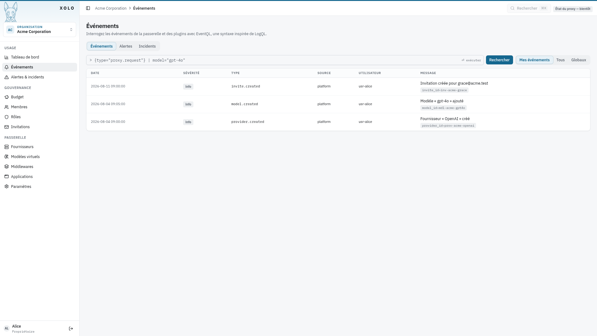
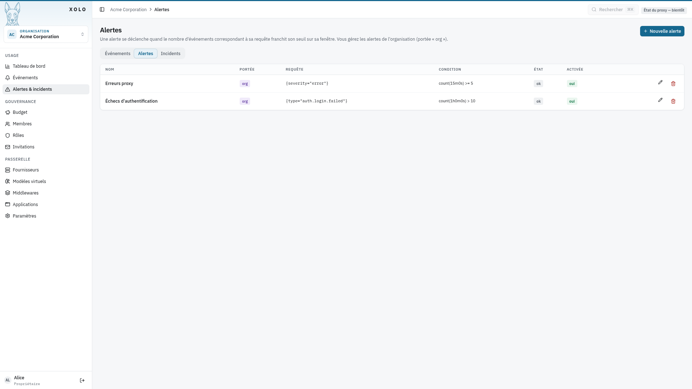
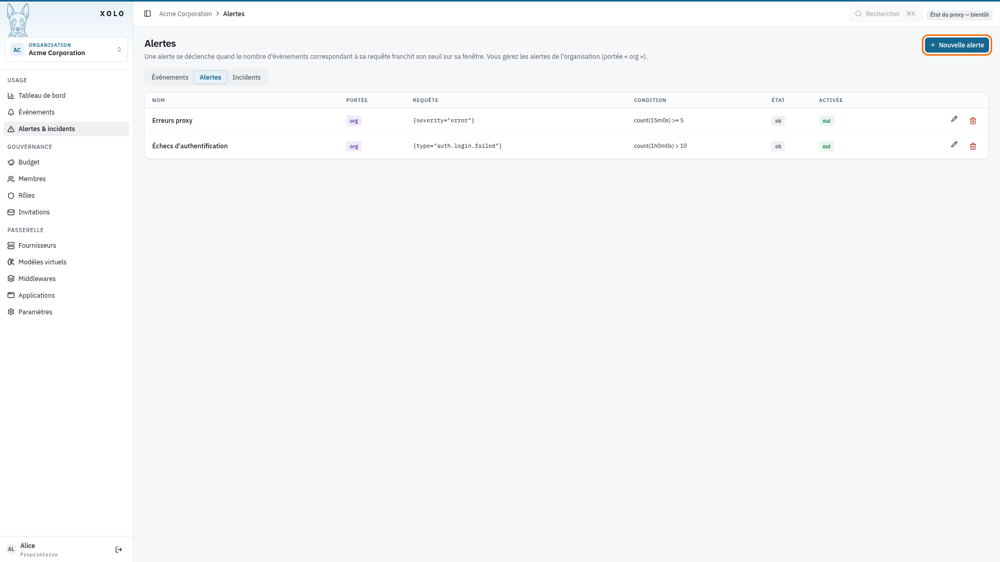
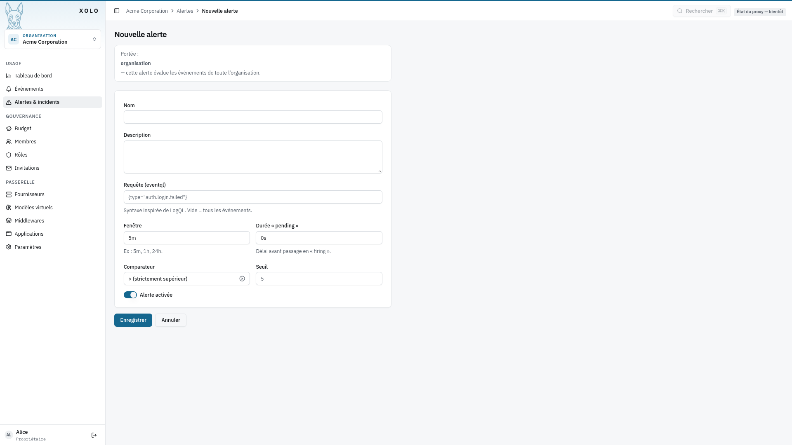
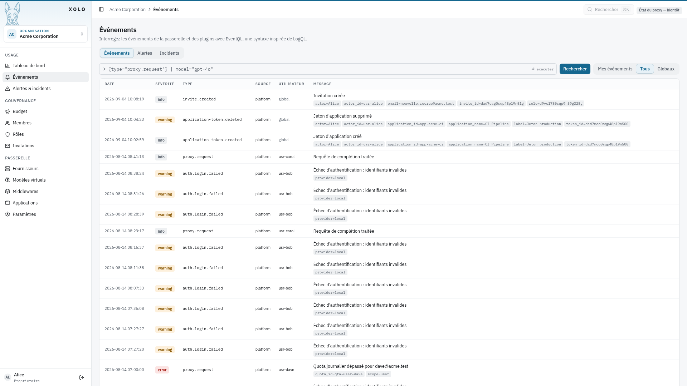

# Événements



## Qu'est-ce qu'un événement ?

Un événement est une entrée de journal qui décrit une action survenue dans Xolo. Les événements servent à tracer l'activité, à diagnostiquer des problèmes et à déclencher des alertes.

### Types d'événements courants

| Type             | Description                             |
| ---------------- | --------------------------------------- |
| `proxy.request`  | Requête API vers un modèle              |
| `proxy.request.failed` | Requête API en échec (fournisseur, timeout, hook) avec le statut HTTP et la cause |
| `proxy.stream.interrupted` | Réponse streamée interrompue avant la fin, avec la cause, le nombre de fragments déjà émis et l'erreur. Émis en complément de `proxy.request`, jamais à sa place |
| `auth.login.failed` | Connexion en échec (ex. compte déjà lié à un autre fournisseur) |
| `middleware.*`   | Création, modification ou suppression d'un middleware |

La liste complète des types émis, avec leurs attributs, figure dans la [référence EventQL](../reference/eventql.md#evenements-de-base).

#### Causes d'interruption de flux

L'attribut `cause` de `proxy.stream.interrupted` prend l'une de ces valeurs. Les deux premières sont des fautes et remontent en `warning`, les deux autres relèvent du trafic ordinaire et restent en `info`.

| Cause | Description |
| --- | --- |
| `upstream_error` | Le fournisseur a échoué en cours de flux, après que des fragments sont parvenus au client. L'erreur est transmise au client sous forme d'événement SSE. |
| `write_failed` | L'écriture de la réponse a échoué pour une raison autre que le départ du client, par exemple une erreur d'entrée/sortie locale. C'est une faute serveur. |
| `client_gone` | Le client est parti : onglet fermé, requête annulée, reverse proxy expiré. |
| `stream_truncated` | Le fournisseur a clos le flux sans signaler la fin ni remonter d'erreur. Le client reçoit malgré tout les événements de clôture habituels. Une connexion amont coupée proprement se présente de la même façon. |

Xolo enregistre un appel interrompu dans l'usage comme n'importe quel autre, car le fournisseur a facturé les tokens produits et le client les a reçus. La colonne `status` de l'enregistrement porte une valeur dérivée de la cause, qui n'en reprend pas le nom dans deux cas sur quatre :

| Cause de l'événement | `status` de l'enregistrement |
| --- | --- |
| `upstream_error` | `interrupted` |
| `write_failed` | `write_failed` |
| `client_gone` | `client_gone` |
| `stream_truncated` | `truncated` |

Xolo enregistre en `interrupted` et remonte en `warning` une cause que sa version ne connaît pas encore. L'enregistrer en « ok » masquerait l'interruption. Quand le fournisseur n'a publié aucun décompte avant la coupure, ce qui est le cas le plus fréquent hors Anthropic, Xolo estime les tokens à partir de la requête et du nombre de fragments émis. L'enregistrement porte alors la source de coût `estimated`.

### Niveaux de sévérité

| Sévérité    | Description                      |
| ----------- | -------------------------------- |
| **info**    | Information générale             |
| **warning** | Avertissement, attention requise |
| **error**   | Erreur                           |

## Accéder aux événements

1. Allez dans votre organisation : `/orgs/{slug}/`
2. Cliquez sur **Événements** dans le menu

> **Note** : vous devez disposer de la permission `events:read:all` pour voir tous les événements de l'organisation.

## Parcourir les événements

### Filtres par portée

| Portée             | Description                           |
| ------------------ | ------------------------------------- |
| **Mes événements** | Uniquement vos propres événements     |
| **Tous**           | Tous les événements de l'organisation |
| **Globaux**        | Inclut les événements de plateforme   |

### Syntaxe de requête (EventQL)

Filtrez les événements avec EventQL, un langage de requête inspiré de LogQL (Grafana Loki). Sa syntaxe complète est décrite dans la [référence EventQL](../reference/eventql.md).

**Exemples :**

```logql
{type="proxy.request"}
{type="auth.login.failed"}
{type="proxy.request"} | model="gpt-4o"
{type="auth.login.failed"} |~ "timeout"
```

### Colonnes affichées

| Colonne         | Description                            |
| --------------- | -------------------------------------- |
| **Date**        | Horodatage de l'événement              |
| **Sévérité**    | Niveau de criticité                    |
| **Type**        | Type de l'événement                    |
| **Source**      | Origine de l'événement                 |
| **Utilisateur** | Utilisateur concerné (ou « global »)   |
| **Message**     | Description de l'événement et attributs |

## Alertes



Une alerte vous notifie lorsque certains événements se produisent.

### Créer une alerte

1. Cliquez sur **Nouvelle alerte**
   

2. Remplissez les informations :
   

   | Champ                 | Description                                      |
   | --------------------- | ------------------------------------------------ |
   | **Nom**               | Nom de l'alerte                                  |
   | **Description**       | Description optionnelle                          |
   | **Requête**           | Requête EventQL (ex. `{type="auth.login.failed"}`) |
   | **Fenêtre**           | Durée d'évaluation (ex. 5m, 1h, 24h)             |
   | **Durée « pending »** | Délai avant passage en « firing »                |
   | **Comparateur**       | Opérateur de comparaison (> >= < <= ==)          |
   | **Seuil**             | Valeur numérique                                 |
   | **Activé**            | Activer ou désactiver l'alerte                   |

3. Cliquez sur **Enregistrer**.

### États d'une alerte

| État        | Description                                    |
| ----------- | ---------------------------------------------- |
| **ok**      | Fonctionnement normal, seuil non atteint       |
| **pending** | Seuil atteint, en attente du délai « pending » |
| **firing**  | Alerte déclenchée                              |

Exemple :


### Portée des alertes

| Portée    | Description                                  |
| --------- | -------------------------------------------- |
| **org**   | Évalue tous les événements de l'organisation |
| **perso** | Évalue uniquement vos propres événements     |

« org » et « perso » sont les badges de la liste des alertes. Les valeurs enregistrées, celles de la [référence EventQL](../reference/eventql.md#portee-des-alertes), sont `org` et `personal`.

## Incidents

Les incidents sont l'historique des alertes déclenchées.

### Informations affichées

| Information               | Description                                   |
| ------------------------- | --------------------------------------------- |
| **Nom de l'alerte**       | Alerte qui s'est déclenchée                   |
| **Date de déclenchement** | Quand l'incident a commencé                   |
| **Date de résolution**    | Quand l'incident a été résolu (si applicable) |
| **Pic**                   | Valeur maximale atteinte                      |
| **État**                  | firing ou resolved                            |
| **Événements épinglés**   | Événements qui ont contribué au déclenchement |

> **Note** : les événements épinglés sont conservés au-delà de la fenêtre glissante habituelle.

## Permissions

| Action                           | Permission requise         |
| -------------------------------- | -------------------------- |
| Consulter ses propres événements | Aucune (accès automatique) |
| Consulter tous les événements    | `events:read:all`          |
| Gérer les alertes d'organisation | `events:write`             |
| Créer des alertes personnelles   | `events:alerts:own`        |
