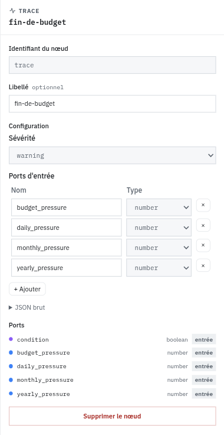
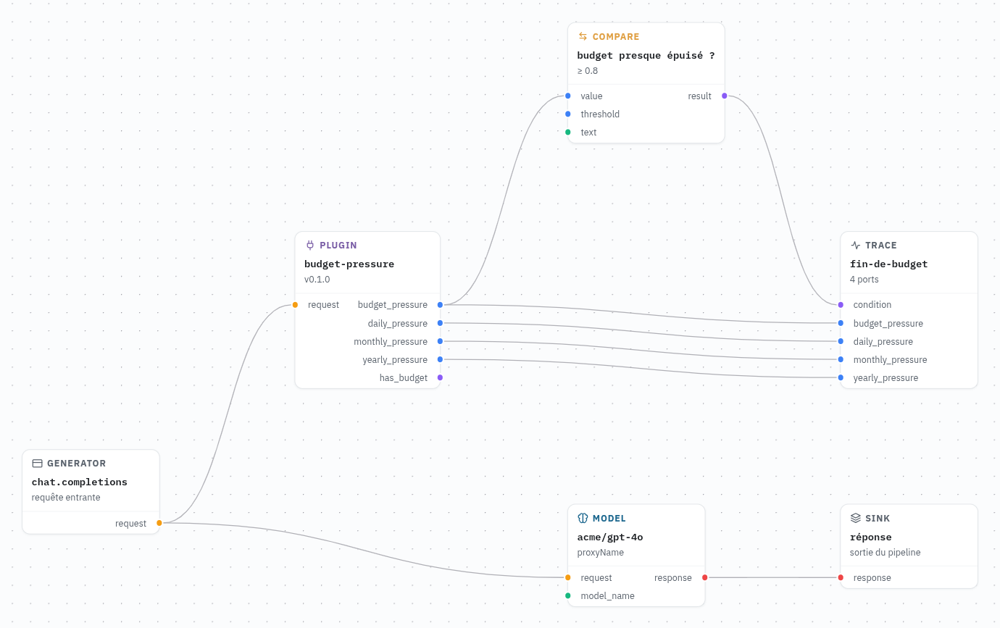
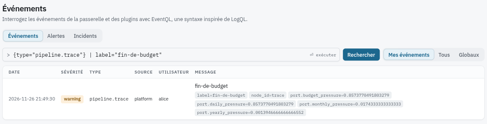
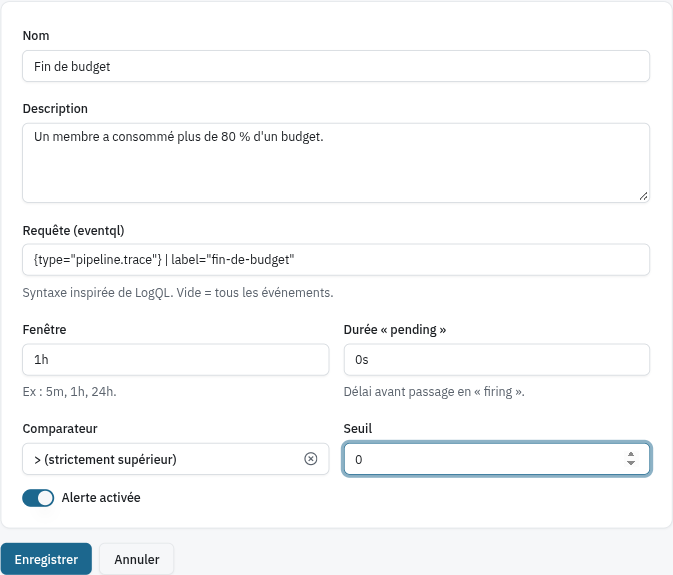
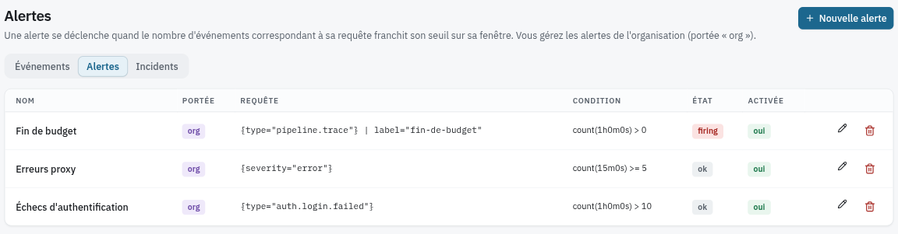

# Guide : lever des événements personnalisés

Le nœud `trace` transforme les valeurs d'un pipeline en événements Xolo. Ces événements se consultent dans la page **Événements** et déclenchent des [alertes](../../evenements/evenement.md#alertes) : un modèle virtuel peut ainsi signaler ce que la plateforme ne surveille pas d'elle-même.

Ce guide construit un modèle virtuel `acme/assistant-budget` qui lève un événement quand un utilisateur approche de la fin de son budget, et une alerte qui prévient avant que le quota ne commence à refuser ses requêtes.

Le fichier [`assistant-budget.bundle.json`](./assistant-budget.bundle.json){ download="assistant-budget.bundle.json" } contient le pipeline : téléchargez-le, puis chargez-le avec le bouton **Importer un bundle** de la page Modèles virtuels. Après import, vérifiez que `acme/gpt-4o` existe dans votre organisation.

## Prérequis

- Une organisation dont vous êtes administrateur, avec la permission d'écrire les modèles virtuels.
- Un budget configuré pour l'organisation, une équipe ou un membre (voir [Budget](../../../administration/organisation/budget/budget.md)). Sans budget, il n'y a rien à surveiller.
- Le plugin `budget-pressure` chargé sur le serveur.
- Pour une alerte d'organisation, la permission `events:write` ; une alerte personnelle ne demande que `events:alerts:own`.

## Ce que produit une trace

Un nœud `trace` enregistre un événement :

| Champ | Contenu |
| --- | --- |
| `type` | `pipeline.trace`, pour toutes les traces |
| `message` | Le libellé du nœud |
| `severity` | Celle de la configuration du nœud : `info`, `warning` ou `error` |
| `user`, `org` | L'appelant et son organisation |
| Attributs | `label` (le libellé), `node_id`, et `port.<nom>` pour chaque port déclaré et connecté |

Les valeurs des ports sont écrites en texte : `true` ou `false` pour un booléen, `0.83` pour un nombre.

Le nœud a toujours une entrée booléenne, `condition`, en plus des ports que vous déclarez. Non connectée, la trace s'enregistre à chaque requête qui la traverse : c'est l'usage pour observer un pipeline. Connectée, elle ne s'enregistre que lorsque la valeur est vraie : la trace devient un **événement personnalisé**, qui n'existe que quand le fait qu'il signale se produit. Elle n'est jamais enregistrée comme attribut, puisqu'elle vaut toujours vrai dans l'événement.

La décision se prend dans le graphe, le plus souvent avec un `compare` sur une mesure. C'est aussi là qu'elle doit se prendre : EventQL compare des chaînes, pas des nombres, et une alerte ne saurait pas dire si `0.83` dépasse `0.8`.

## Étape 1 : le modèle virtuel

Un pipeline ne s'exécute que sur les requêtes qui le traversent : pour observer les budgets, il faut un modèle virtuel par lequel passent les requêtes des utilisateurs. Celui-ci se contente de transmettre au modèle ; tout son intérêt est dans ce qu'il observera en chemin.

Créez un modèle virtuel nommé `assistant-budget` et ouvrez son éditeur (voir [Modèle virtuel](../../../administration/organisation/virtual_model/virtual_model.md)). Ajoutez un nœud `model` réglé sur `acme/gpt-4o`, reliez `generator.request` à `model.request` et `model.response` à `sink.response`.

## Étape 2 : mesurer et décider

Quand le quota refuse une requête, il est trop tard : l'utilisateur est bloqué et l'administrateur l'apprend par une plainte. Pour prévenir avant, il faut mesurer la consommation à chaque requête et décider, dans le graphe, du moment où elle devient préoccupante. Le seuil de 80 % laisse le temps d'ajuster un budget ou de prévenir l'utilisateur.

Ajoutez le plugin `budget-pressure` et reliez `generator.request` à son port `request`. Ses sorties donnent la part déjà consommée du budget le plus tendu qui s'applique à la requête, celui de l'utilisateur, de son organisation ou de son équipe :

| Port | Contenu |
| --- | --- |
| `daily_pressure`, `monthly_pressure`, `yearly_pressure` | La part consommée sur le jour, le mois, l'année, de 0 à 1 |
| `budget_pressure` | La plus élevée des trois |
| `has_budget` | Vrai si un budget s'applique |

Ajoutez un `compare` libellé « budget presque épuisé ? », opérateur `gte`, seuil 0,8, et reliez `budget-pressure.budget_pressure` à son port `value`. Son `result` est vrai dès que 80 % d'un budget est consommé.

## Étape 3 : la trace

La décision prise dans le graphe n'existe que le temps de la requête. Pour qu'elle serve, il faut qu'elle laisse une trace qu'on puisse consulter et sur laquelle on puisse alerter : c'est le rôle du nœud `trace`, qui ne l'écrira que lorsque la décision est positive.

Ajoutez un nœud `trace` et reliez `compare.result` à son port `condition`. Son libellé, `fin-de-budget`, devient le message de l'événement et la clé par laquelle l'alerte le retrouvera. Réglez la sévérité sur `warning` : l'événement ne s'enregistre que lorsqu'il y a de quoi s'inquiéter, et une requête EventQL peut le distinguer des simples observations avec `severity="warning"`.

Déclarez ensuite les ports qui diront, le jour où l'événement se produit, quel budget est en cause, un nom et un type chacun :

| Port | Type | Relié à |
| --- | --- | --- |
| `budget_pressure` | number | `budget-pressure.budget_pressure` |
| `daily_pressure` | number | `budget-pressure.daily_pressure` |
| `monthly_pressure` | number | `budget-pressure.monthly_pressure` |
| `yearly_pressure` | number | `budget-pressure.yearly_pressure` |

Nommez les ports d'après ce qu'ils reçoivent : l'événement se lit alors sans rouvrir le graphe. Ne déclarez pas de port nommé `condition` : ce nom est celui de l'entrée fixe.

Enregistrez. Le bandeau indique **Graphe valide**.

## Étape 4 : vérifier

Une alerte posée sur un événement qui ne s'enregistre jamais reste silencieuse, et ce silence ressemble à une bonne nouvelle. Avant de poser l'alerte, vérifiez que l'événement apparaît quand il le doit, et seulement à ce moment-là.

Envoyez une requête à `acme/assistant-budget` avec un utilisateur loin de sa limite : aucun événement `fin-de-budget` ne s'enregistre. Avec un utilisateur qui a consommé plus de 80 % d'un budget, la page **Événements**, avec la requête `{type="pipeline.trace"} | label="fin-de-budget"`, montre l'événement. Celui-ci a été enregistré pour un membre d'Acme dont l'organisation avait consommé 86 % de son budget du jour :

Le budget du jour est le plus tendu : c'est lui qui donne `budget_pressure`. Celui du mois n'est entamé qu'à 2 %.

Pour vérifier le montage sans attendre qu'un budget s'épuise, baissez provisoirement le seuil du `compare` sous la pression actuelle, envoyez une requête, puis remettez-le à 0,8.

## Étape 5 : l'alerte

Un événement dans une page que personne ne consulte ne prévient personne. L'alerte transforme l'événement en signal : elle compte les occurrences sur une fenêtre de temps, se déclenche au premier, et garde la trace de chaque déclenchement dans les incidents.

Dans **Événements › Alertes**, cliquez sur **Nouvelle alerte** :

| Champ | Valeur |
| --- | --- |
| **Nom** | Fin de budget |
| **Requête** | `{type="pipeline.trace"} \| label="fin-de-budget"` |
| **Fenêtre** | `1h` |
| **Comparateur** | `>` |
| **Seuil** | 0 |

L'alerte compte les événements `fin-de-budget` de la dernière heure et se déclenche dès le premier. La même requête, dans la page **Événements**, montre qui est en cause et les valeurs de ses ports.

La portée décide de qui est surveillé. Une alerte d'organisation évalue les requêtes de tous les membres : c'est celle d'un administrateur qui veut ajuster un budget à temps. Une alerte personnelle n'évalue que les requêtes de celui qui la crée : chaque membre peut la poser pour lui-même, et apprendre qu'il approche de sa limite avant d'être refusé.

## D'autres événements, la même méthode

La recette tient en trois nœuds : une mesure, un `compare` qui décide, une `trace` dont la condition reçoit la décision. Quelques variantes :

| Événement | Condition de la trace | Requête d'alerte |
| --- | --- | --- |
| `contexte-long` : un utilisateur envoie de très longues conversations | `compare` `gte` 50 000 sur `request-inspector.input_tokens` | `{type="pipeline.trace"} \| label="contexte-long"` |
| `risque` : une demande suspecte passe sous le seuil de refus | `compare` `gte` 0,4 sur `prompt-guard.risk`, ou directement son port `suspicious` | `{type="pipeline.trace"} \| label="risque"` |
| `expert-week-end` : le [modèle `acme/auto`](../selection-automatique/selection-automatique.md) sollicite son modèle expert le week-end | `context.is_weekend` | `{type="pipeline.trace"} \| label="expert-week-end" \| port.model_name="acme/expert"` |

Quand la décision est déjà un booléen, comme `suspicious` ou `is_weekend`, il se branche directement sur `condition`, sans `compare`. Et une condition ne dit pas tout : dans la dernière ligne, l'alerte filtre en plus sur la valeur d'un port déclaré, le nom du modèle retenu.

## Ce qu'il faut savoir

- **Sans condition, un événement par requête.** Une trace dont `condition` n'est pas connectée écrit un événement à chaque requête qui la traverse. Sur un modèle virtuel très sollicité, c'est autant de lignes dans la base : gardez ces traces pour mettre au point un pipeline ou suivre une mesure, et connectez la condition de celles qui servent d'alerte.
- **Une condition sans valeur laisse passer l'événement.** Si le nœud relié à `condition` ne produit rien, un plugin absent par exemple, la trace s'enregistre comme si elle n'avait pas de condition : un événement de trop se remarque, un événement perdu non. Une valeur qui n'est ni un booléen ni un nombre est traitée de même, avec un avertissement dans le journal du serveur ; un nombre compte comme vrai s'il n'est pas nul.
- **La trace s'exécute avant l'appel au modèle.** Elle enregistre ce que le graphe sait de la requête, pas ce que le modèle a répondu ni les tokens consommés : ceux-là sont dans les événements `proxy.request` et dans le [tableau de bord](../../dashboard/dashboard.md).
- **Une requête refusée peut ne pas être tracée.** Un plugin qui refuse à l'entrée, comme `prompt-guard` au-dessus de son seuil, arrête la requête avant que la trace ne s'exécute. Ces refus ont leurs propres événements.
- **Les noms comptent.** Le libellé du nœud et le nom de chaque port deviennent des attributs. Les changer casse les alertes qui les citent.
- **Toute l'organisation, pas un modèle.** Ce modèle virtuel ne surveille que ses propres requêtes. Le même graphe, avec la case **Passthrough** cochée sur le nœud `model`, devient un [middleware](../../../administration/organisation/middleware/middleware.md) qui surveille les requêtes de tous les modèles.

Le détail du nœud est dans la [référence des nœuds intégrés](../../../concepts/noeuds-pipeline/noeuds-integres.md#trace), et la syntaxe des requêtes dans [EventQL](../../../concepts/eventql.md).
