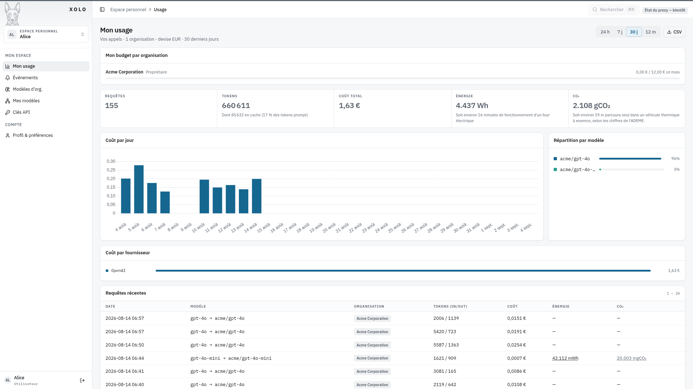

# Tableau de bord

## Qu'est-ce que le tableau de bord ?

Le tableau de bord (Dashboard) récapitule votre activité et vos dépenses dans Xolo.

## Accéder au tableau de bord

1. Connectez-vous à Xolo.
2. Xolo vous redirige vers le tableau de bord.

URL : `/usage`

## Sélecteur de période

Choisissez la période d'affichage :

- **1j** : dernières 24 heures
- **7j** : 7 derniers jours
- **30j** : 30 derniers jours
- **90j** : 90 derniers jours
- **180j** : 180 derniers jours
- **365j** : année complète

### Exporter les données

Cliquez sur **Exporter CSV** pour télécharger les données au format CSV.

## Cartes de résumé

Le tableau de bord affiche des cartes récapitulatives :

| Métrique | Description |
|----------|-------------|
| **Requêtes** | Nombre total d'appels API effectués |
| **Tokens** | Total de tokens utilisés (dont cache) |
| **Coût total** | Dépense totale dans la devise de l'organisation |
| **Énergie** | Consommation estimée en watt-heures (Wh) |
| **CO2** | Émissions de CO2 avec équivalent en km parcourus |

## Graphiques

### Coût par jour

Histogramme affichant l'évolution des coûts journaliers sur la période sélectionnée.

### Coût par modèle

Répartition des coûts sous forme de camembert, par modèle utilisé.

### Coût par fournisseur

Histogramme montrant la répartition des coûts par fournisseur LLM.

## Estimation énergétique et CO2

Xolo calcule les métriques **Énergie** et **CO2** à partir du modèle utilisé, du nombre de tokens et du niveau d'infrastructure du fournisseur. Il convertit aussi les émissions en kilomètres parcourus en voiture pour faciliter la lecture.

Pour la méthodologie complète (formules, plages d'incertitude, sources), voir la page [Estimation énergétique et carbone](../decouvrir/estimation-energetique.md).

## Tableau des requêtes

Le bas du tableau de bord affiche une liste paginée des requêtes avec :

| Colonne | Description |
|---------|-------------|
| **Date** | Horodatage de la requête |
| **Modèle** | Modèle LLM utilisé |
| **Tokens** | Nombre de tokens consommés |
| **Coût** | Coût de la requête |

## Changer d'organisation

Si vous appartenez à plusieurs organisations, utilisez le menu déroulant dans l'en-tête pour passer de l'une à l'autre.

## Tableau de bord de l'organisation

En tant qu'administrateur, vous accédez aussi au tableau de bord de l'organisation :

URL : `/orgs/{slug}/usage`

Il affiche les mêmes informations pour l'ensemble de l'organisation.
